## {.title-hero data-state="title-hero"}

```{=html}
<div class="hero">
  <div class="hero-left">
    <div class="hero-kicker">GenAI &amp; Social Science Conference &middot; NYU &amp; Columbia &middot; 2026</div>
    <h1 class="hero-title">Humans show limited ability to distinguish human&#8209;authored and AI&#8209;generated political content on social&nbsp;media</h1>
    <div class="hero-rule"></div>
    <p class="hero-presenter"><strong>Tiago Ventura</strong> (Georgetown University)</p>
    <p class="hero-authors">With Sejin Paik, Rebecca Ansell, Leticia Bode, Autumn Toney&#8209;Wails, and Lisa Singh</p>
  </div>
</div>
```

::: aside
[Paik, S., Ventura, T., Ansell, R., Bode, L., Toney-Wails, A., & Singh, L. Humans show limited ability to distinguish human-authored and AI-generated political content on social media. *Proceedings of the National Academy of Sciences*, forthcoming.]{.midgrey}
:::

::: {.notes}
- Thank organizers; joint work with Georgetown colleagues
:::


## Motivation {.sec-intro}

::: {.incremental}

- **GenAI represent a critical shift on content production** LLMs can mass-produce text that mimics human tone, syntax, and affect, and those can easily circulate online

- **Several episodes of AI generated content during the 2024 U.S. elections:** LLM-written campaign material, deepfake robocalls imitating candidates, and AI images and videos of politicians [(Goldmacher 2023; Ramer 2025; Corsi et al. 2024; Malik 2025)]{.midgrey}

- **Public concern about AI usage as a deception tool**: Policy experts ranked misinformation and disinformation the #1 global risk[(WEF Global Risks Report 2024)]{.midgrey}

- **Platforms struggle catch it particularly for short text.** [(Mantzarlis and Dutta 2025; Wittenberg et al. 2023)]{.midgrey}. Understanding [audience's perceptions]{.red} is critical.

  - People struggle to tell AI from human political conten for election disinformation [(Williams et al. 2025)]{.midgrey}


:::

::: {.notes}
- LLMs write human-sounding text at scale; it sits in the same feeds as real posts
- 2024: LLM campaign material, deepfake robocalls, AI images of politicians
- Labels don't scale; the reader is the last line of defense
- Prior work: people struggle, rely on surface cues -- we ask *where* detection fails
:::


## Research questions {.center .sec-intro}


::: {.nonincremental}

1. Can people distinguish human-authored from AI-generated posts, across [LLMs]{.red} and [platforms]{.red}? 

   - And we try to do it with distinct measurement strategy focusing on humanness of AI-generated content
   
2. Which [textual and emotive features]{.red} make a post being perceived as more human?

3. Which [individual traits]{.red} predict who detects AI content?

4. How does [partisan identity]{.red} shape how human an AI persona looks?

:::

::: {.notes}
- RQ1: can people tell -- by model and platform?
- RQ2: which features read as human?
- RQ3: who detects better?
- RQ4: does partisanship bias judgments?
:::


## Setting: the September 10, 2024 Harris-Trump debate {.center .sec-intro}

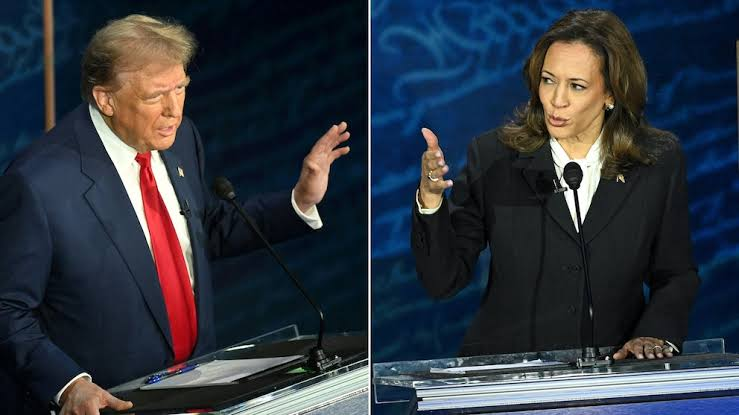{fig-align="center" height="660"}

::: {.notes}
- All posts, human and AI, react to this one debate
- High-salience event: lots of real-time posts on every platform
- Same topic for everything, so differences come from authorship, not subject
:::


## Preview of the Results {.sec-intro visibility="hidden"}

**A qualified yes:** people detect AI content above chance, but only slightly ([58.6%]{.red}). Detection gets worse for:

- Newer models
- X/Twitter posts
- Co-partisan AI personas

::: {.notes}
- Qualified yes: 58.6% accuracy
- Breaks down for Llama 3.3, on X/Twitter, and for co-partisan personas
:::


## Pair-wise Comparison of Human and AI-Generated Content {.center .sec-design}

:::fragment
**Stimuli:** 2,386 posts on the Sept. 10, 2024 Harris-Trump debate

- **Human-authored (696):** X/Twitter, Truth Social, and YouTube and TikTok comments
- **AI-generated (1,690):** six LLMs (GPT-4, GPT-4o, GPT-4o mini, Llama 2, Llama 3.2, Llama 3.3) × five political personas (Progressive, Liberal, Moderate, Conservative, Libertarian Populist)
:::

:::fragment
**Prompting:** each LLM writes 20 posts per persona, with platform-tailored instructions

- **X/Twitter, Truth Social:** full debate transcript; 70-279 characters, varied punctuation, emojis, and hashtags
- **YouTube, TikTok:** transcripts of the same debate videos humans commented on; comment-style, 5-50 words
:::

:::fragment
**Pre-processing on both AI and Human text:** 

- mentions → @USER, 
- URLs → placeholder links, English only (LangDetect), 
- for AI posts, unique first five words and malformed emoji tokens removed
- Remove extremely short text after the pre-processing (<40chars)
:::
::: {.notes}
- 2,386 posts on the Sept. 10, 2024 debate: 696 human, 1,690 AI
- Human: X, Truth Social (hashtags); YouTube, TikTok (comments on 10 videos each)
- AI: 6 LLMs x 5 personas, 20 posts each, platform-tailored prompts
- Same cleaning for both: @USER, placeholder URLs, English only
:::


## Measurement Task {.sec-design}

:::fragment
**Task:** "Which of the posts (Post A or Post B) is more likely to have been generated by an AI chatbot?"

- Two survey waves (March and July 2025), **N = 1,122** on Connect, 30 pairs per respondent
- Pair type (Human-AI, Human-Human, AI-AI) randomized; 19,500 unique pairs
:::

:::fragment
**Measurement:** Bradley-Terry scaling, estimated separately for each platform

-  **Estimate** latent strengths: $\text{logit}\, P(i \text{ picked as AI over } j) = \gamma_i - \gamma_j$ (binomial GLM, MLE)\
- **PHI:** rank posts within each platform and rescale to [-1 (most AI-like) to +1 (most human-like)]{.red}, centered at 0 
- More AI than human posts, so 0 falls inside the AI distribution 
- **The quantity of interest** Perceived Humanness Score (PHI) and gap between human vs AI posts
:::

::: {.notes}
- Task: pick which post is more likely AI; 1,122 people, 30 pairs each
- Bradley-Terry per platform: logit P(i over j) = gamma_i - gamma_j
- Rank within platform, rescale to -1 (AI) / +1 (human)
- 0 = median post, inside the AI distribution -- look at the human-AI gap
- Full estimation in backup
:::


## Example: posts across the PHI scale {.center .sec-design}

:::: {.columns}

::: {.column width="32%"}

**GPT-4o mini, Moderate persona**

> Kamala really needs to define her stance on healthcare! It's a crucial issue.

[PHI = **-0.97** -- read as AI]{.blue}

:::

::: {.column width="36%"}

**Human-authored, X/Twitter**

> Why would Kamala bring up Trump inviting the Taliban when HE ACTUALLY WAS NEGOTIATING PEACE? Which actually worked… and then Kamala violated the terms of the agreements and violence returned… thank you Kamala for giving points to Trump. #Debate2024

[PHI = **0.10** middle of the scale]{.blue}

:::

::: {.column width="32%"}

**Llama 2, Liberal persona**

> Did Donald Trump really say we should "bomb the shitout of 'em"? 😨 #WarMonger # DebateNight.

[PHI = **0.96** read as human]{.blue}

:::

::::

::: {.notes}
- Left to right along the PHI scale
- GPT-4o mini (YouTube), polished and earnest: PHI -0.97, read as AI
- Real X post, long and angry: PHI 0.10, middle of the pack
- Llama 3.3 (YouTube), short and emotional: PHI 1.00, read as human
- The most human-looking post is AI; previews Llama 3.3 and the emotion results
:::


# RQ1: Detection across LLMs and platforms {.rq-divider .d1}

Can people distinguish human-authored from AI-generated posts?


## Human posts beat 5 of 6 LLMs on humanness -- but not Llama 3.3 {.center .rq1}

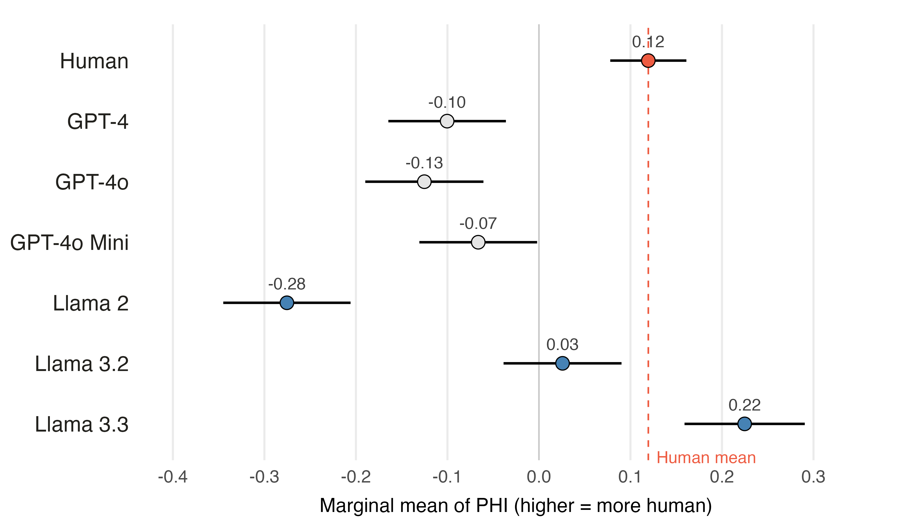{fig-align="center" width="85%"}

::: {.notes}
- Human posts score above 5 of 6 models
- Llama 3.3 scores above the humans (0.22 vs 0.12)
- Llama 2 easiest, Llama 3.3 hardest: ~18 months apart
- Possible reason (untested): Meta trained Llama on Facebook/Instagram data
:::


## Detection is above chance, but only barely: 58.6% accuracy {.center .rq1}

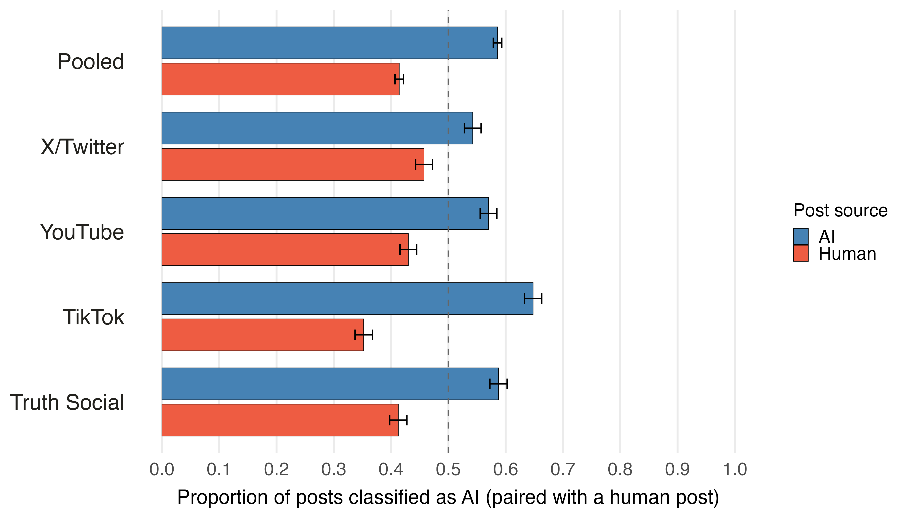{fig-align="center" width="85%"}

::: {.notes}
- Human-AI pairs only: how often people pick the AI post
- 58.6% overall -- above chance, but weak
- TikTok best (65%), X/Twitter worst (54%)
:::


## The lower a post's PHI, the more often people flag it as AI {.center .rq1}

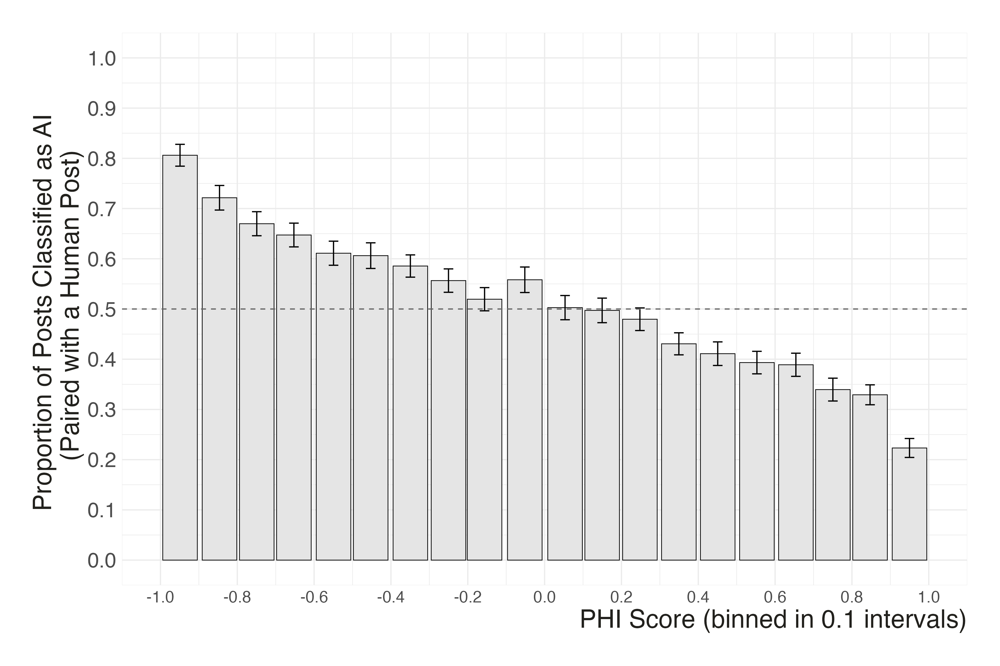{fig-align="center" width="68%"}

::: {.notes}
- PHI vs detection rate, binned
- ~80% flagged at PHI = -1, ~22% at +1
- Higher PHI = picked as AI less often
:::


## Against Llama 3.3, detection falls to 52% -- barely above chance {.center .rq1}

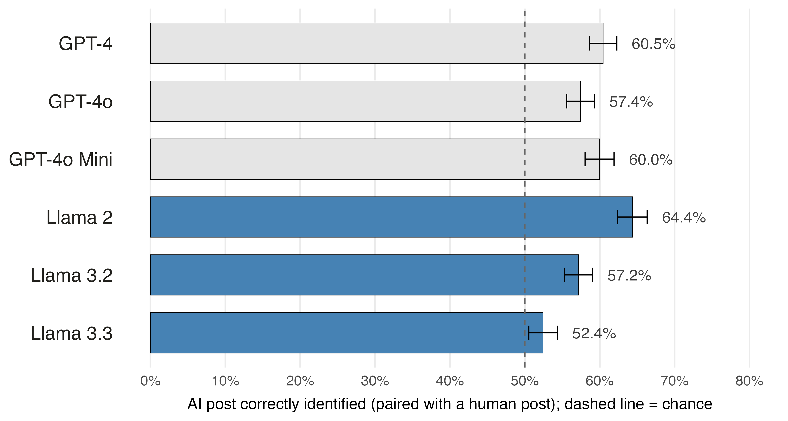{fig-align="center" width="85%"}


::: {.notes}
- Llama 2 easiest (64%); GPT models 57-61%
- Llama 3.3: 52% [50.5, 54.3] -- barely above chance
:::


## On X/Twitter, human and AI posts are almost indistinguishable {.center .rq1}

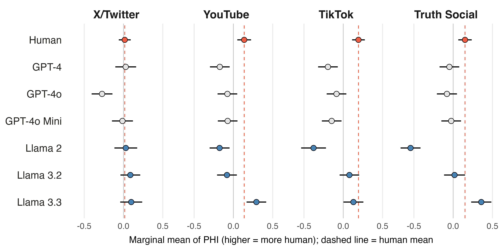{fig-align="center" width="95%"}

::: {.notes}
- YouTube, TikTok, Truth Social: clear human-AI gap
- X/Twitter: only GPT-4o differs from humans
- Matters: X is central to political talk
:::


## On X, hashtags and links likely make real posts look fake {.center .rq1}

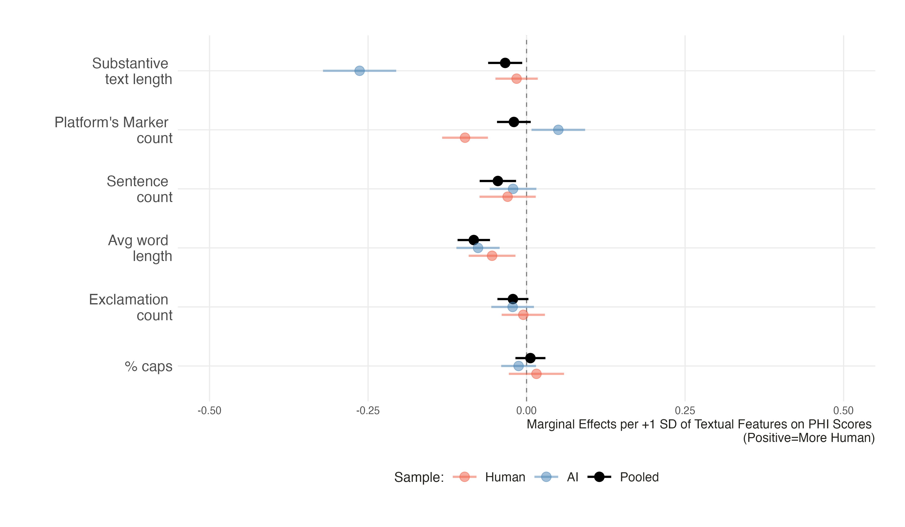{fig-align="center" width="85%"}

::: {.notes}
- Real tweets: 56% have a URL vs 1% of AI tweets; more hashtags, mentions, RTs
- More markers -> lower PHI for human posts
- Likely read as signs of automation
- Longer text gives AI posts away
:::


## A zero-shot LLM beats humans at the same task -- especially on X {.center .rq1}

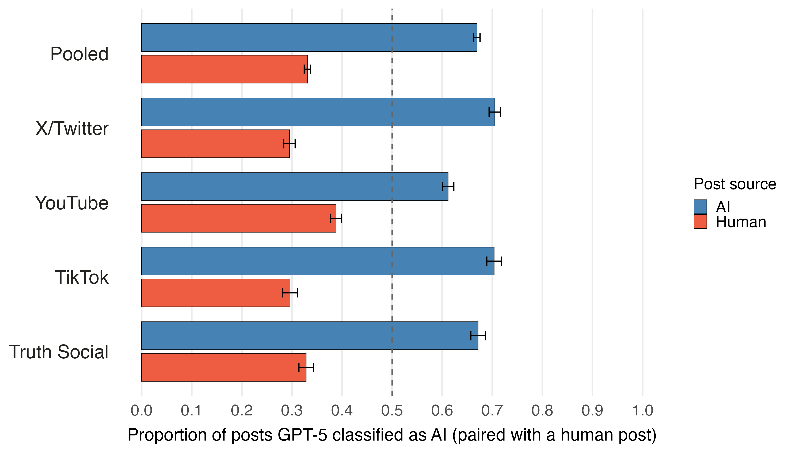{fig-align="center" width="85%"}

::: {.notes}
- GPT-5, same question, same pairs, zero-shot
- 67% overall vs 58.6% for people
- X/Twitter: 70.5% vs 54% -- the signal is there, people misread it
- Neither is a reliable detector
:::


# RQ2: Textual and emotive features {.rq-divider .d2}

Which features make a post read as human?


## Emotion and incivility read as human; positivity reads as AI {.center .rq2}

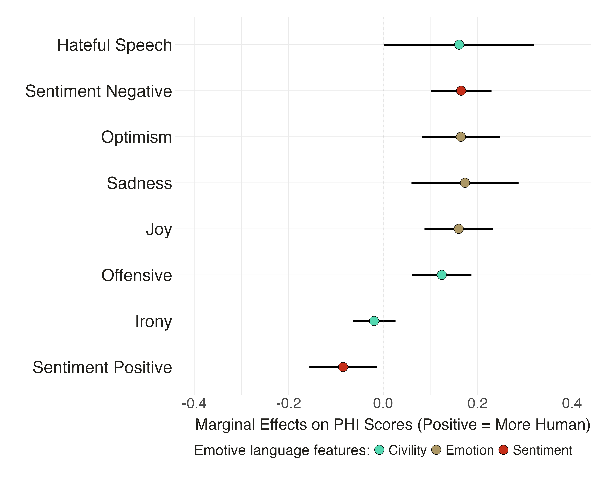{fig-align="center" height="720"}

::: {.notes}
- TweetEval labels; OLS on PHI
- Offensive, hateful, joy, optimism, sadness, negative -> more human
- Positive sentiment -> more AI
- People expect chatbots to be polite and upbeat
:::


## These cues work the same for human and AI posts {.center .rq2}

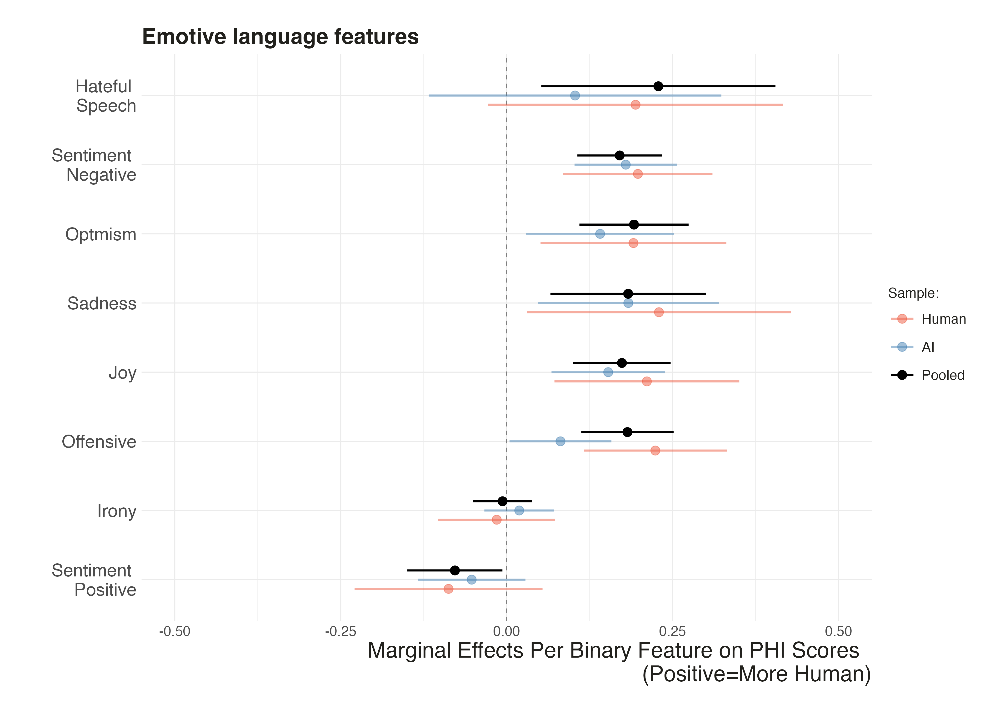{fig-align="center" width="62%"}

::: {.notes}
- Effects split by human vs AI posts
- Same boost for both (joint test p = 0.26)
- A heuristic people apply, not a real difference they detect
:::


## Respondents rely on grammar and emojis -- and read both as AI {.rq2 visibility="hidden"}

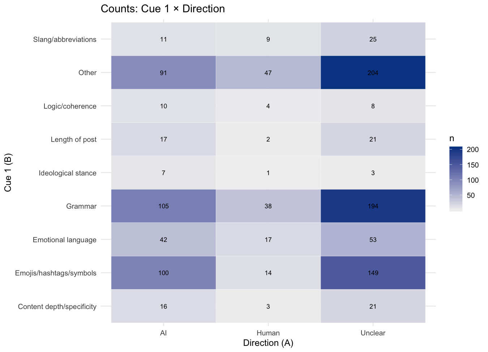{fig-align="center" width="62%"}

::: {.notes}
- Top cues: grammar (337), emojis/hashtags (263)
- Both point to AI
- Big 'unclear' group
:::


# RQ3: Individual traits {.rq-divider .d3}

Who is better at detecting AI content?


## Individual differences in detection are small {.center .rq3}

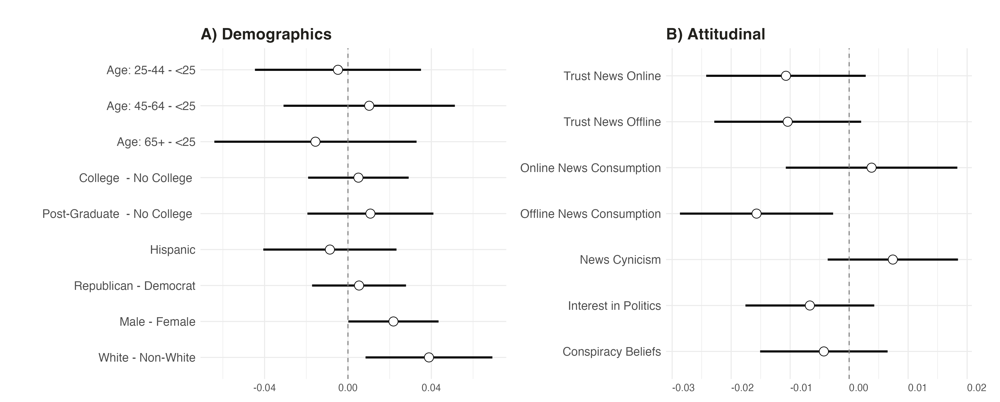{fig-align="center" width="95%"}

::: {.notes}
- Human-AI pairs, mixed logit, AMEs
- Men +2 pp, white +3 pp, offline news -1.5 pp
- Everything else ~0; exploratory
:::


## X news users spot AI better on X {.rq3 visibility="hidden"}

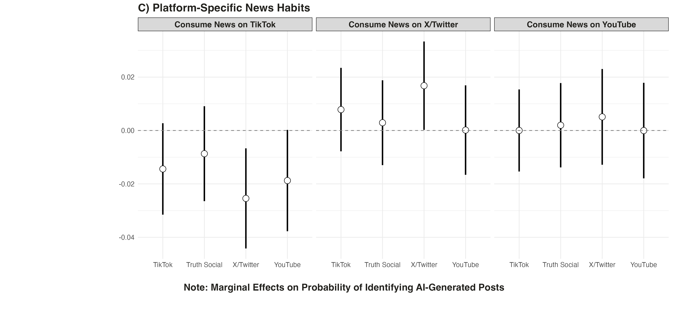{fig-align="center" width="85%"}

::: {.notes}
- X news users better on X posts (+1.6 pp)
- TikTok news users worse on X and YouTube
:::


## Frequent chatbot users detect AI content better {.center .rq3}

| Follow-up (May 2026, n = 723 of 1,122) | Logit coef. |
|----------------------------------|------------|
| [AI use frequency]{.red} | [0.138\*\*\* (0.039)]{.red} |
| Digital literacy | 0.053 (0.032) |
| Offline news consumption | -0.092\* (0.039) |

::: {.fragment}

- Men are earlier and heavier AI users and score higher on digital literacy
- White respondents rely more on offline news and use AI *less*
- Returners don't differ from non-returners on detection accuracy (p = 0.75)

:::

::: {.notes}
- Recontacted 723 of 1,122 (May 2026); no difference in detection
- AI use frequency is the only predictor
- Men: earlier, heavier AI users; white: more offline news
- Suggestive, not causal
:::


# RQ4: Partisan congruence {.rq-divider .d4}

Do partisan leanings shape how human an AI persona looks?


## Republicans see pro-attitudinal AI personas as more human {.center .rq4}

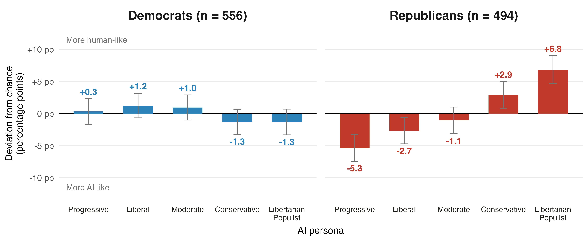{fig-align="center" width="100%"}

::: aside
[AI-AI pairs only: no correct answer, so differences reflect partisan bias.]{.midgrey}
:::

::: {.notes}
- AI-AI pairs only: no correct answer
- Democrats: flat
- Republicans: populist/conservative AI more human, progressive/liberal more AI
- Gaps vs Democrats: populist 8 pp, progressive 6 pp
:::


## Can people tell human from AI political content? A qualified yes {.center .sec-concl}

- **RQ1 Detection:** a [limited]{.red} defense -- 58.6% accuracy, falling to 52% for Llama 3.3 and 54% on X/Twitter; zero-shot GPT-5 reaches 67%

- **RQ2 Features:** emotional, uncivil, negative posts read as human; polished, positive ones as AI

- **RQ3 Individual traits:** differences are small; frequent chatbot users detect AI content better

- **RQ4 Partisanship:** Republicans rate pro-attitudinal AI personas as more human


::: {.notes}
- RQ1: 58.6%, worse for Llama 3.3 and on X
- RQ2: emotion and incivility read human
- RQ3: small gaps; chatbot use helps
- RQ4: Republicans favor co-partisan AI
- Target safeguards where detection fails
:::


## {.title-hero data-state="title-hero"}

```{=html}
<div class="hero">
  <div class="hero-left">
    <div class="hero-kicker">Takeaway</div>
    <h1 class="hero-title closing">Humans detect AI&#8209;generated political content only slightly above chance, and detection fails for newer models, on X/Twitter, and for co&#8209;partisan personas</h1>
    <div class="hero-rule"></div>
    <p class="hero-presenter"><strong>Thank you!</strong></p>
    <p class="hero-authors">tiago.ventura@georgetown.edu</p>
    
  </div>
</div>
```

::: {.notes}
- Limited defense, predictable failures
- Thank you -- questions
:::


## Backup: Bradley-Terry estimation of PHI {.smaller .sec-backup visibility="uncounted"}

**Data.** For each platform, judgments $k = 1, \dots, K$: post $w(k)$ picked as AI over post $l(k)$; self-pairs dropped

**Model.** Each post $i \in \{1, \dots, N\}$ has a latent strength $\gamma_i$:

$$P\big(w(k) \succ l(k)\big) = \frac{e^{\gamma_{w(k)}}}{e^{\gamma_{w(k)}} + e^{\gamma_{l(k)}}} \quad\Longleftrightarrow\quad \text{logit}\, P = \gamma_{w(k)} - \gamma_{l(k)}$$

**Estimation.** Logistic GLM without intercept, fit by maximum likelihood (statsmodels GLM, Binomial family)

- Design matrix $X_{ki} = +1$ if $i = w(k)$, $-1$ if $i = l(k)$, $0$ otherwise; outcome $y_k = 1$ for all $k$

**Identification.** $\gamma$ is identified only up to an additive constant: drop one column, fixing $\gamma_{\text{ref}} = 0$

**Recentering and rescaling.** Rank $r_i \in \{0, \dots, N-1\}$ of $\hat\gamma_i$ within platform, then invert so higher = more human:

$$\text{PHI}_i = -\left(-1 + \frac{2\, r_i}{N - 1}\right)$$

- PHI is a uniform grid on $[-1, 1]$ with mean and median 0 on each platform; rankings do not depend on the reference post
- Each post was paired with ~10 others (Survey 1: X/Twitter, YouTube) or 20 others (Survey 2: Truth Social, TikTok)

::: {.notes}
- Each click = contest; post picked as AI wins
- Logit with +1/-1 design, y = 1, no intercept
- One post fixed at 0 (identification); ranks unaffected
- Rank, rescale, flip sign
:::


## Backup: the political lean of human posts doesn't drive PHI {.center .sec-backup visibility="uncounted"}

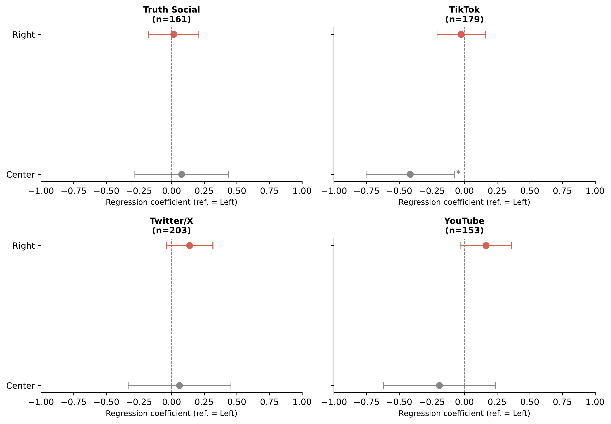{fig-align="center" width="70%"}

::: {.notes}
- Right-leaning content is the majority on every platform
- No consistent effect of lean on PHI
:::


## Backup: PHI distributions overlap most on X/Twitter {.center .sec-backup visibility="uncounted"}

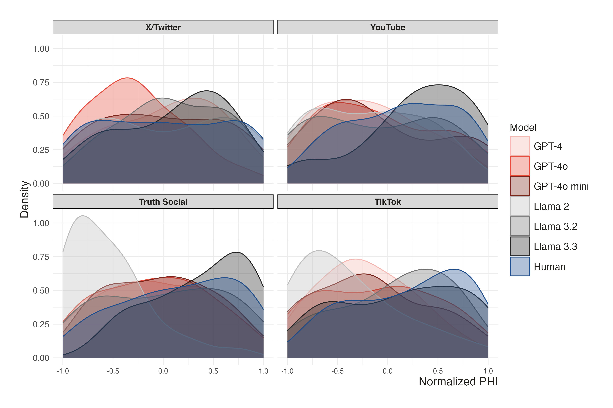{fig-align="center" width="72%"}

::: {.notes}
- On X, all curves overlap
- Elsewhere, Llama 2 at the AI end; Llama 3.3 and humans at the human end
:::
