## Short Recap of the Elections {.center}

- **Lula (PT)** (Incumbent, Workers Party, running for a fourth term) 
 vs **Flávio Bolsonaro (PL)** (senator for Rio de Janeiro, Liberal Party, son of the former right-wing President). 

- Jair Bolsonaro was convicted of leading a coup plot. In custody since Nov 2025; serving at home.

- Flávio finished first, 47.0% to 45.2%. Runoff this next sunday

- Gubernatorial Elections: 20, out of 27, elected in the first round. 

- Congress: Strong results in the House and Senate for Bolsonaro's party (PL)

## Presidential Results {.center}

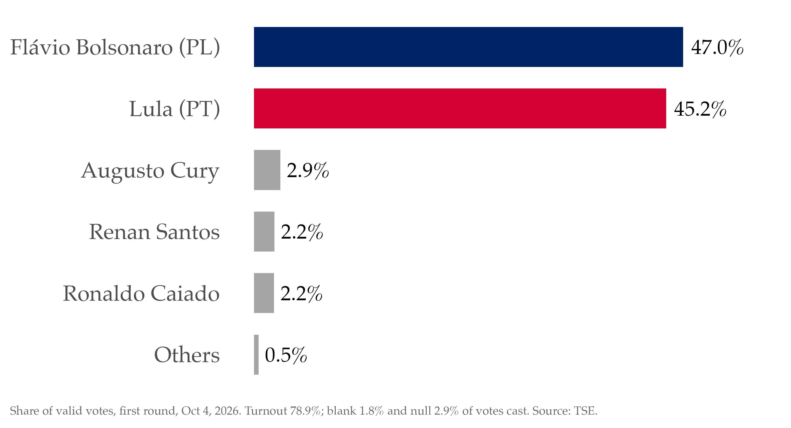{fig-align="center" width="85%"}

::: notes
Takeaway: Flávio finished first, 47.0% to 45.2%. Runoff on Sunday.
:::

## Presidential Results {.center}

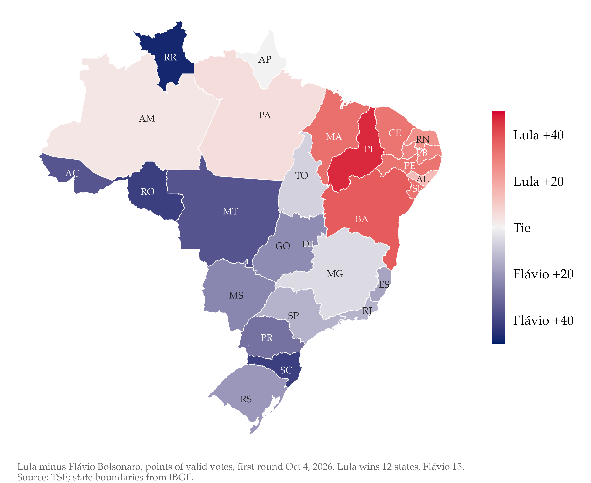{fig-align="center" width="62%"}

::: notes
Takeaway: The map looks a lot like 2022.
:::

## Presidential Results {.center visibility="hidden"}

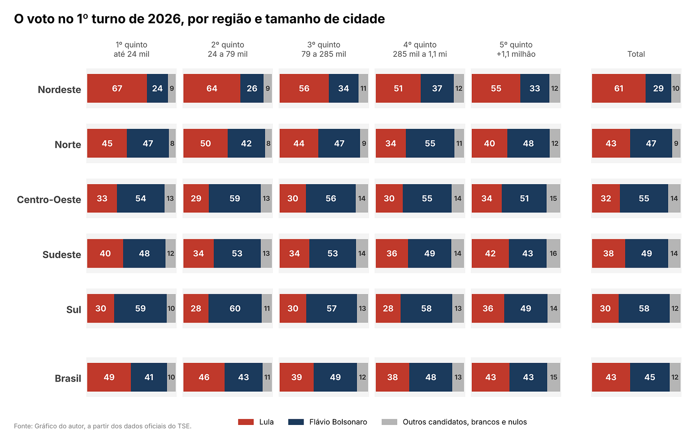{fig-align="center" width="88%"}

::: aside
[Figure: Jairo Nicolau, "Quatro tópicos sobre a abstenção", *Política & Dados*, Oct 8, 2026. Shares of all votes, including blank and null.]{.midgray}
:::

::: notes
Takeaway: Lula wins the Northeast. The right wins almost everywhere else.

The five biggest Southeast cities (SP, Rio, BH, Guarulhos, Campinas) split 43-42. Highest abstention (24%) and the most divided electorate.
:::

## Polls during the threee months of campaign {.center}

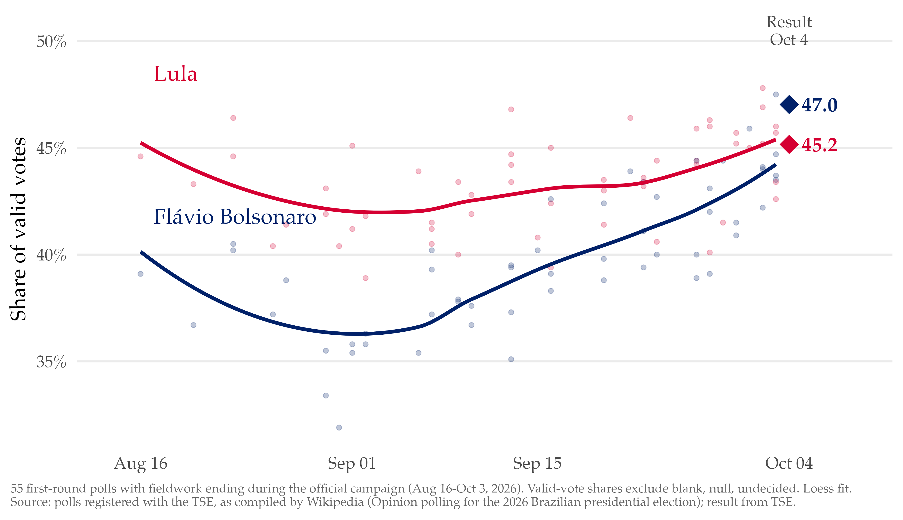{fig-align="center" width="88%"}

**Takeaway:** Polls had Lula ahead for the whole campaign. Flávio closed the gap in the final weeks.

## Gubernatorial Elections {.center}

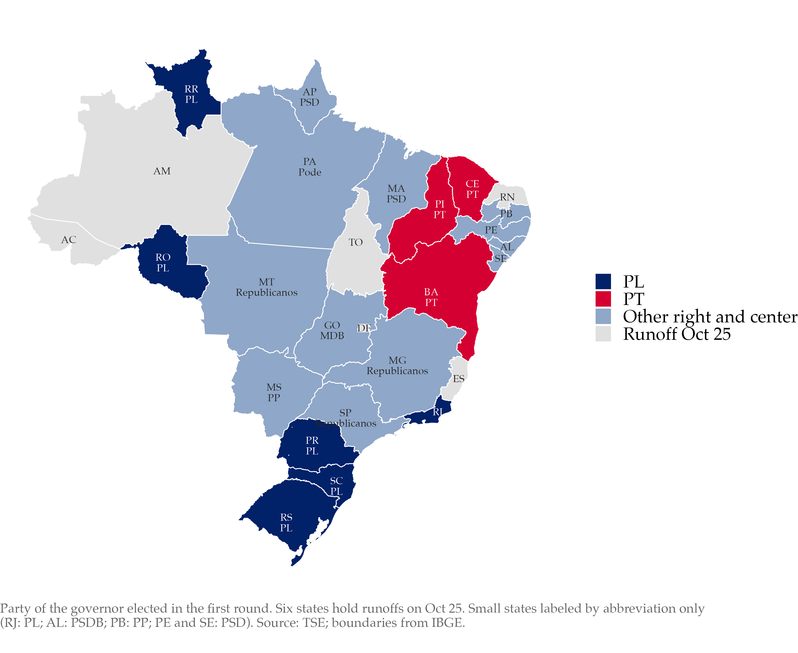{fig-align="center" width="62%"}

The PL won six governorships outright + aligned Governos in key states (SP and MG). The PT won three.

## Senate {.center}

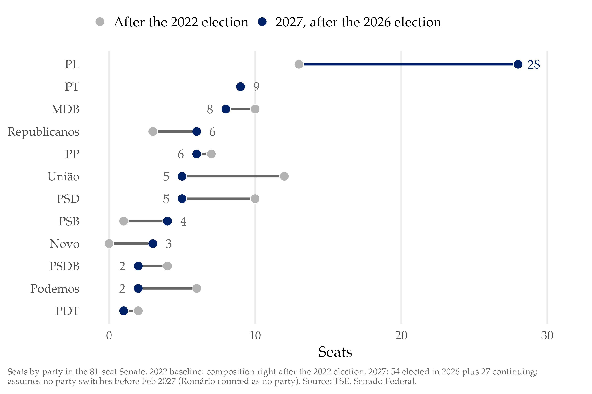{fig-align="center" width="82%"}

The PL more than doubled in the Senate: from 13 to 28 seats. The party won Both seats in DF,SC, RJ, MS and RO. 

:::

## House {.center}

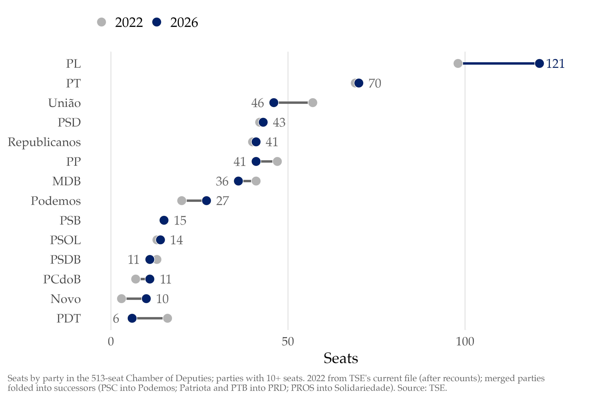{fig-align="center" width="82%"}

- **Takeaway I :** The PL elected 121 deputies, the largest caucus in 40 years.

- **Takeaway II :** PL grew considerably. PT remained basically the same. Center-right (UB, PP, and others) lost space. 

# What happened? {background-color="#23395b"}

## The talk {.center}

This election can be understood with a mix of **structural long-term processes** in Brazilian and World politics. And some **new and interesting patterns** that need us to spend time understandin further

:::: {.columns}

::: {.column width="50%"}
**What is old?**

- Electoral stability
- An anti-incumbent effects
- The economy matters less than it used to
:::

::: {.column width="50%"}
::: {.fragment}
[What is new?]{.blue}

- A right-wing turn in South America + Trump's politics in the continent
- The consolidation of a right-wing partisan identity in Brazil
- New issues in the digital space: platforms without a social graph. 
:::
:::

::::

# What is old? {background-color="#23395b"}

## A fairly simple story: municipalities voted in 2026 almost exactly as in 2022. {.center}

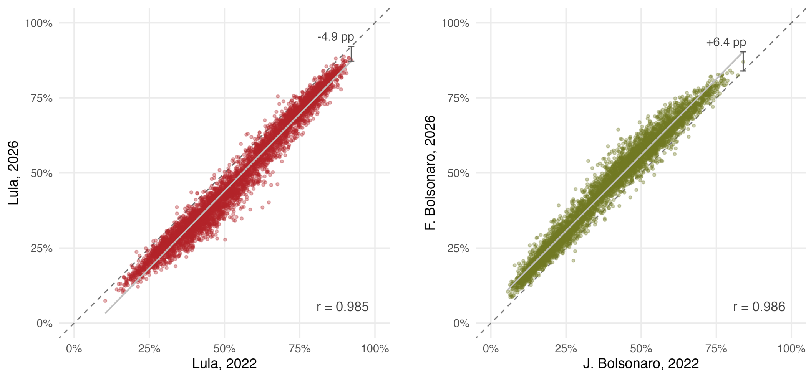{fig-align="center" width="85%"}

::: aside
[Cesar Zucco (Michigan, Oct 2026).]{.midgray}
:::

## Election Stability {.center}

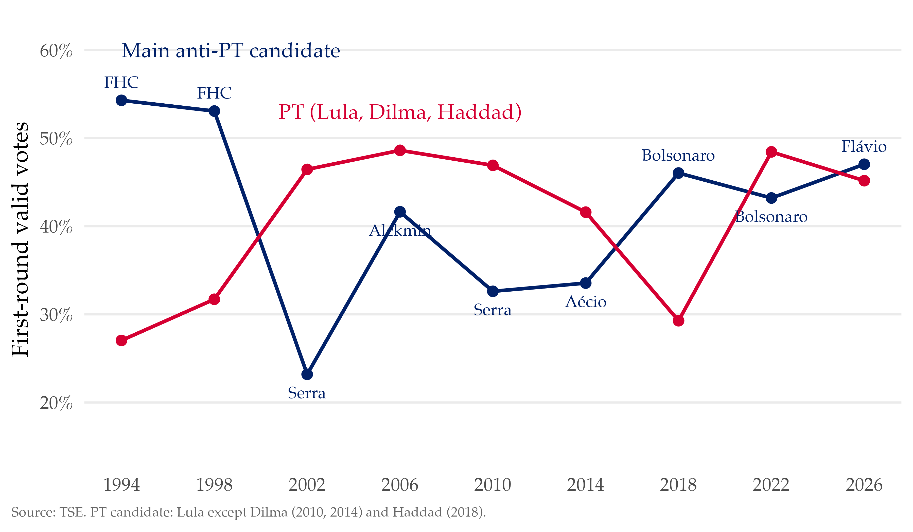{fig-align="center" width="85%"}

::: notes
Takeaway: Three decades of PT versus anti-PT, and the anti-PT side is back on top.
:::

## Slightly higher abstention. But nothing unusual {.center}

::: {.panel-tabset}

### Over time

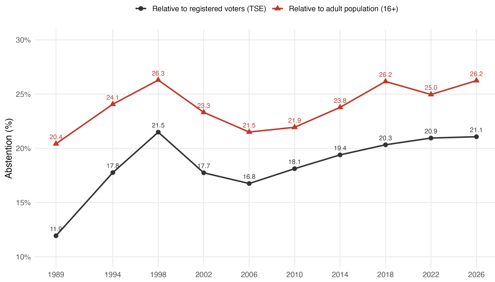{fig-align="center" width="70%"}

### By region and city size

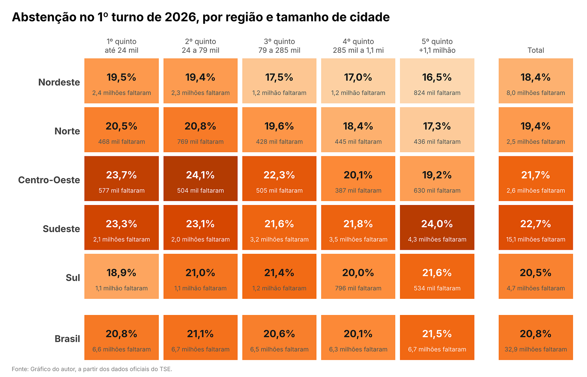{fig-align="center" width="78%"}

:::

::: aside
[Cesar Zucco (Michigan, Oct 2026). Jairo Nicolau, *Política & Dados*, Oct 8, 2026.]{.midgray}
:::

## Some specific groups turnout more than others {.center}

::: {.panel-tabset}

### Age and sex

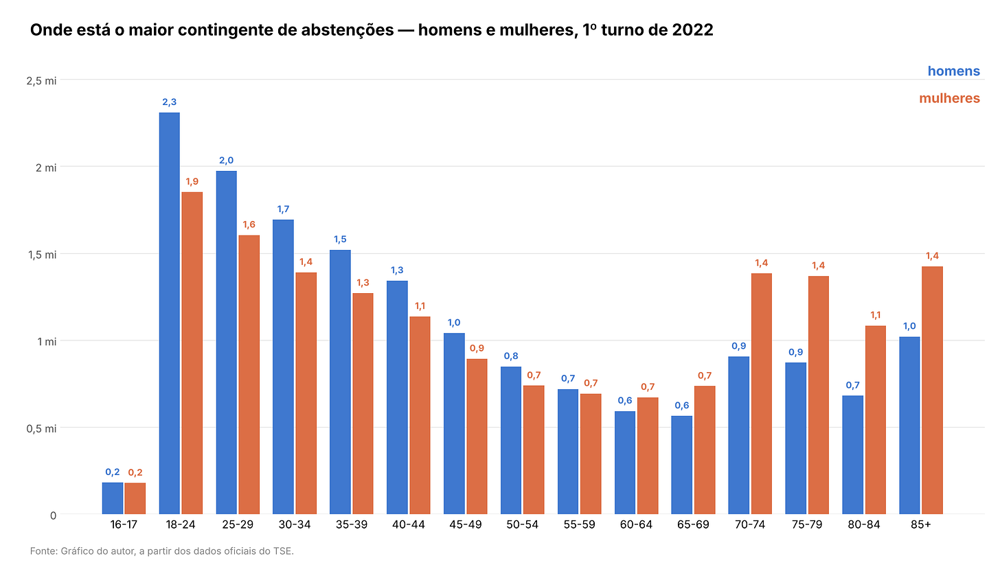{fig-align="center" width="85%"}

### 70+ by education and sex

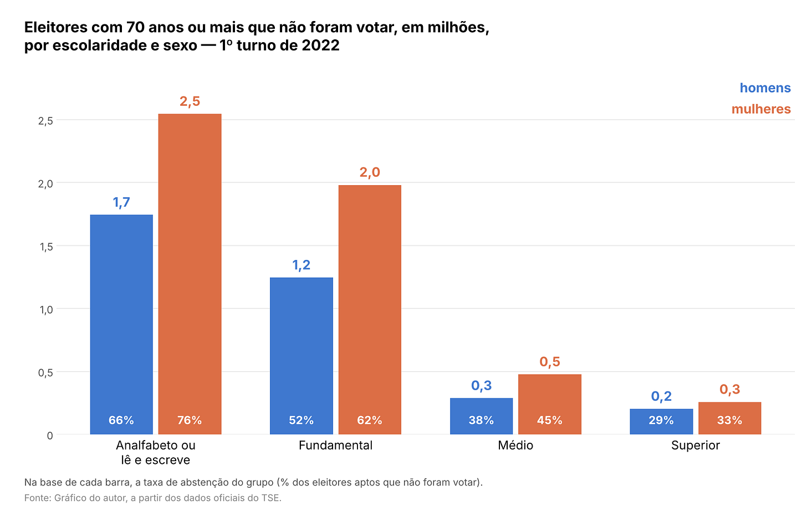{fig-align="center" width="75%"}

:::

::: aside
[Figures: Jairo Nicolau, "Quatro tópicos sobre a abstenção", *Política & Dados*, Oct 8, 2026. Number of abstainers, first round of 2022; 2026 breakdowns are not yet published.]{.midgray}
:::

::: notes
Among those required to vote, the biggest group of abstainers is 18-29: 7.7M (4.3M men, 3.5M women). Abstention falls with age until 69, then jumps at 70+, when voting stops being mandatory. Among those not required to vote, low-education older women stand out: 2.5M illiterate or barely literate women 70+ stayed home, a 76% abstention rate. Nicolau's point for the runoff: young women and older women are Lula's most efficient mobilization targets.
:::

## An ordinary result: presidential popularity predicts the vote. {.center}

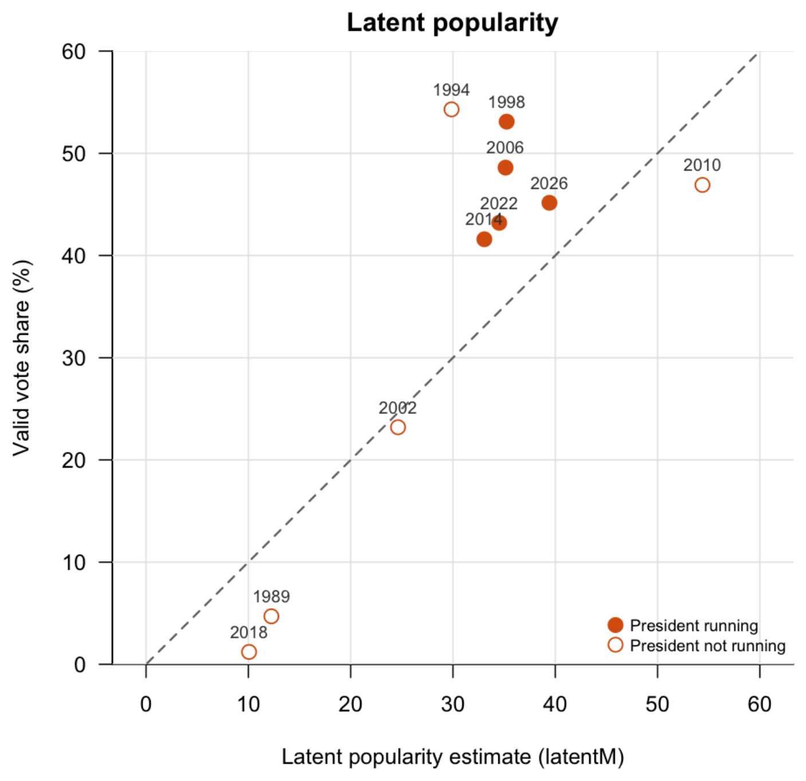{fig-align="center" width="52%"}

::: aside
[Cesar Zucco (Michigan, Oct 2026).]{.midgray}
:::

## Popularity of the last three elected Presidents {.center}

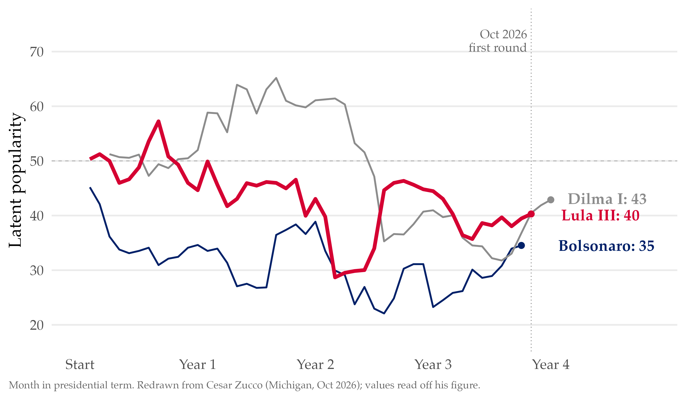{fig-align="center" width="85%"}

::: aside
[Cesar Zucco (Michigan, Oct 2026).]{.midgray}
:::

## Anti-incumbency Wave {.center .nostretch}

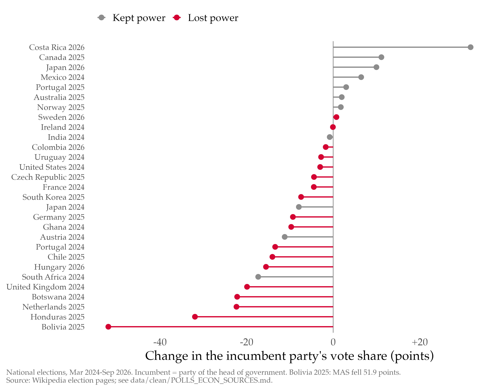{fig-align="center" height="640px"}

**Takeaway:** Incumbents lost vote share in 21 of 29 elections since 2024.

## Anti-incumbency Wave in Latin America {.center}

Brazil is part of a broader, hemispheric pattern:

::: {.incremental}
- **Argentina (Oct 2025):** the midterms left Javier Milei, the right-wing president, in a stronger position
- **Bolivia (Oct 2025):** voters ended almost 20 years of MAS rule and elected Rodrigo Paz
- **Honduras (Nov 2025):** Hondurans voted out the governing Libre party and elected a conservative, Nasry Asfura
- **Chile (Dec 2025):** the conservative José Antonio Kast won the presidency
- **Peru (Jun 2026):** Keiko Fujimori, daughter of a former president convicted of serious human-rights abuses, won a runoff
- **Colombia (Jun 2026):** the right-wing Abelardo de la Espriella narrowly beat Iván Cepeda, ending Colombia's first left-wing government
:::

## The Economy and the Elections {.center}

**Good Economic Times (GET)** [(Campello and Zucco 2016, 2020)]{.midgray}

- An index of the world economy as it hits Brazil: **commodity prices** and **international interest rates**
- High commodity prices and low international rates mean good times
- Neither is under the president's control

::: {.fragment}
The long-term story:

1. International conditions (GET) predict the economy
2. The economy predicts presidential popularity
3. Popularity predicts elections
:::

::: aside
[Campello and Zucco, "Presidential Success and the World Economy", *Journal of Politics* 78(2), 2016; *The Volatility Curse*, Cambridge University Press, 2020.]{.midgray}
:::

## Better economic conditions increase President's popularity {.center}

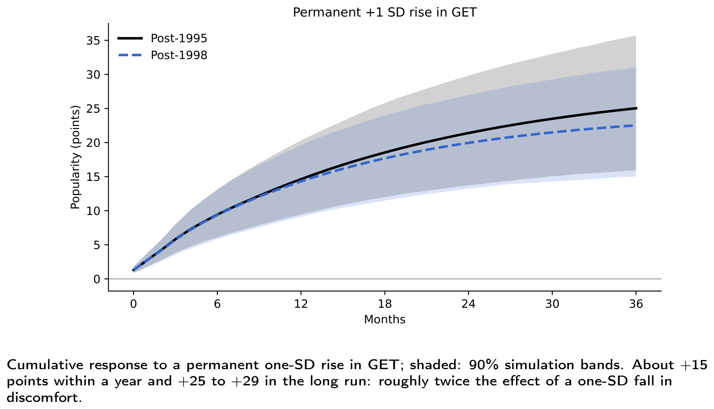{fig-align="center" width="78%"}

::: aside
[Cesar Zucco (Michigan, Oct 2026).]{.midgray}
:::

::: notes
A permanent one-SD rise in GET adds about 15 points of popularity within a year and 25 to 29 points in the long run, roughly twice the effect of a one-SD fall in the discomfort index (unemployment plus 1.7 times 12-month inflation). Shaded areas are 90% simulation bands; the two lines are models estimated from 1995 and from 1998.
:::

## Lula III vs. Model Prediction for popularity

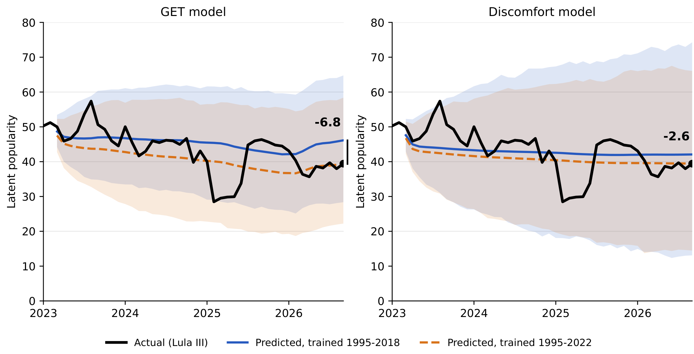{fig-align="center" width="85%"}

::: notes
Takeaway: Under the old rules, this economy would have carried Lula.

Black line: Lula III's actual popularity. Blue and orange: what a typical president would have had given the same economy, from models trained on 1995-2018 and 1995-2022. Lula ends 6.8 points below the GET model and 2.6 below the discomfort model.
:::

## The 2016-2020 structural break 

-  Political meltdown in Brazil
-  Long-term effects of the Pandemic, 
-  Russian war
-  Increased polarization (everywhere?)
-  Social media

# New issues {background-color="#23395b"}

## Right-wing Turn in South America {.center}

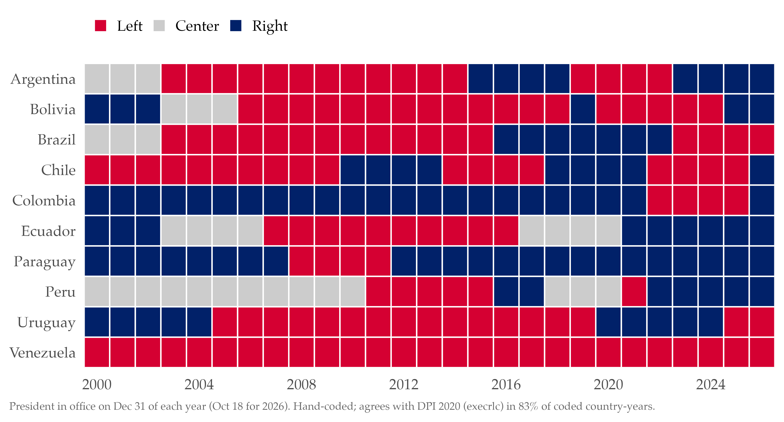{fig-align="center" width="88%"}

::: notes
Takeaway: The pink tide is gone: three of ten South American presidents are on the left.

Peak of 8 left presidents (2008-14). Left in 2026: Brazil, Uruguay, Venezuela (Delcy Rodríguez, acting, after the US captured Maduro on Jan 3, 2026).
:::

## Right-wing Turn in South America {.center}

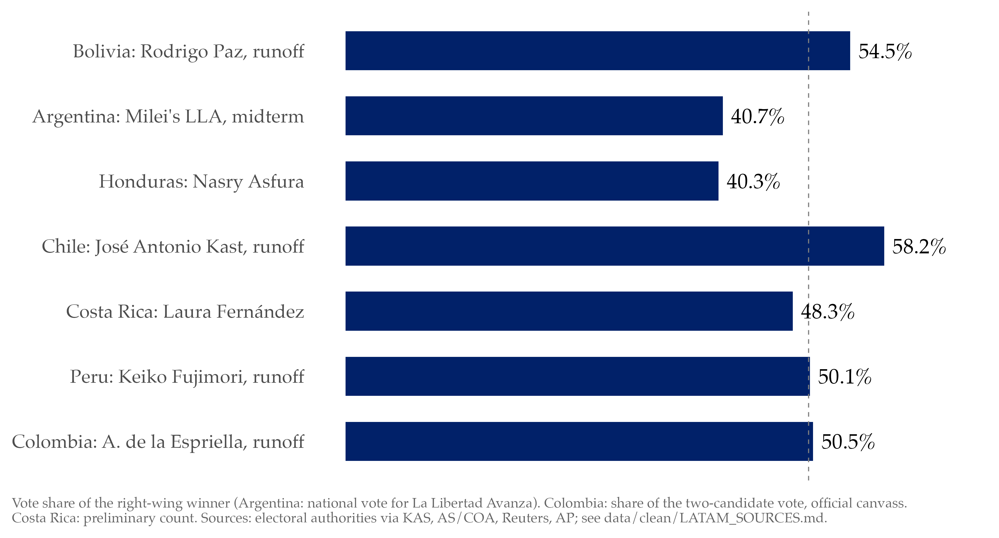{fig-align="center" width="85%"}

::: notes
Takeaway: Since October 2025 the right has won seven straight contests.

Security decided most of these races. Cost of living mattered in Argentina and Bolivia. Trump endorsed Asfura, Milei and De la Espriella. Colombia: ends the country's first left-wing government. Chile: Kast, often described as far-right. Peru: Fujimori by 49,641 votes.
:::

## Right-wing Turn in South America {.center}

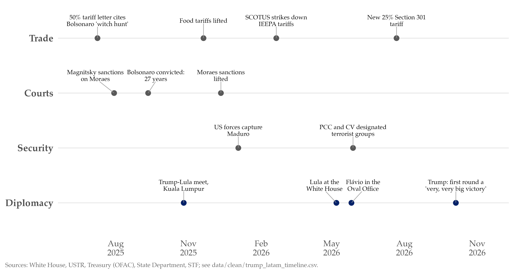{fig-align="center" width="92%"}

::: notes
Takeaway: Trump has been a player in Brazilian politics since July 2025.

The July 2025 tariff letter tied 50% tariffs to the Bolsonaro trial. The Supreme Court struck down the IEEPA tariffs in Feb 2026; a 25% Section 301 tariff took effect in July 2026. Flávio met Trump in the Oval Office in May with no endorsement. On Oct 5 Trump called the first round "a very, very big victory."
:::

## Right-wing Turn in South America {.center}

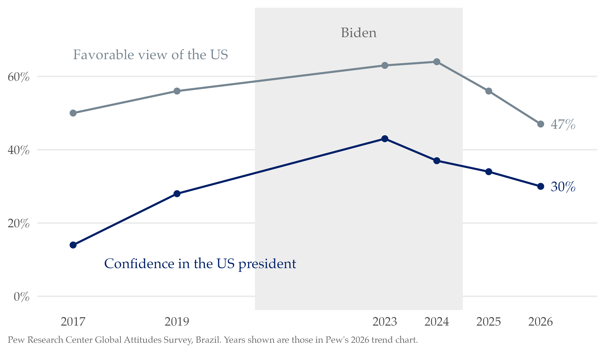{fig-align="center" width="78%"}

::: notes
Takeaway: Brazilians cooled on the US under Trump II.

Latinobarómetro 2026 (press-reported): 30% of Brazilians approve of Trump's international handling, 61% disapprove.
:::

## Right-wing Identity in Brazil {.center}

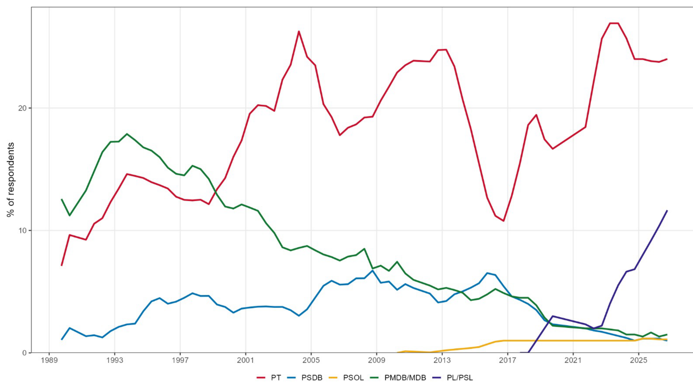{fig-align="center" width="85%"}

::: aside
[Cesar Zucco (Michigan, Oct 2026).]{.midgray}
:::

::: notes
Takeaway: For the first time, a right-wing party has mass partisans.
:::

## Right-wing Identity in Brazil {.center}

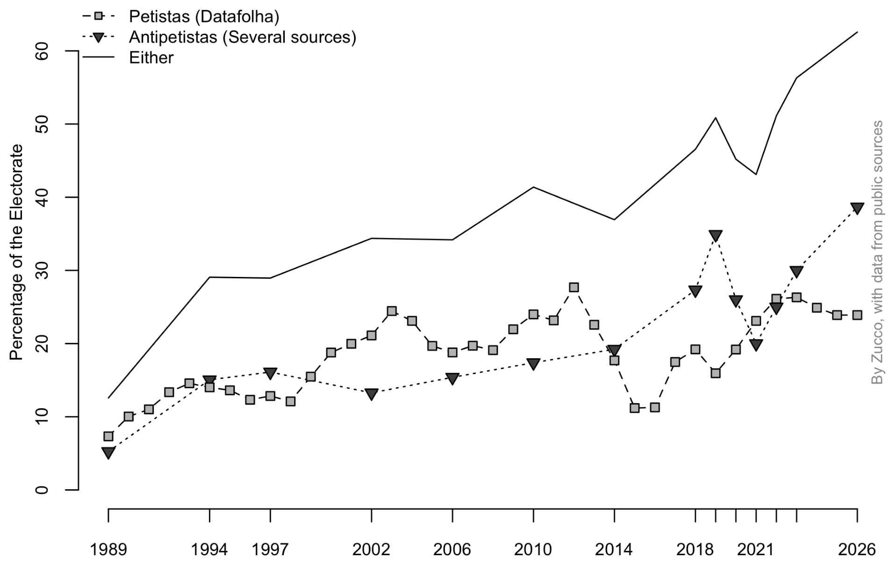{fig-align="center" width="62%"}

::: aside
[Cesar Zucco (Michigan, Oct 2026).]{.midgray}
:::

::: notes
Takeaway: Anti-petismo now rivals petismo.
:::

## Right-wing Identity in Brazil {.center}

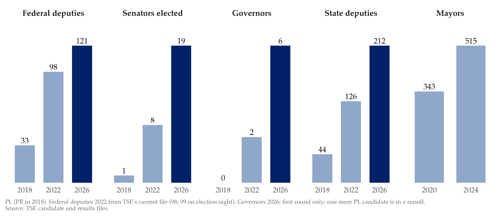{fig-align="center" width="95%"}

::: notes
Takeaway: The PL built a machine across every level of office.
:::

## Right-wing Identity in Brazil {.center}

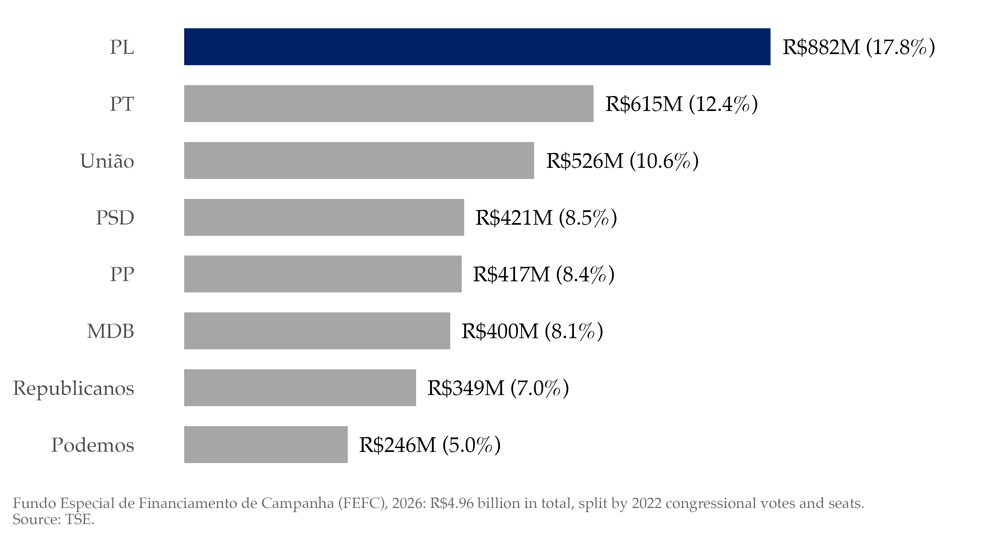{fig-align="center" width="78%"}

::: notes
Takeaway: And it is now the richest party in Brazil.

Not the biggest by members: MDB 2.02M, PT 1.67M, PL 955k (8th). PL also gets the largest share of the Fundo Partidário (16.1% in 2025).
:::

## The Role of Social Media {.center}

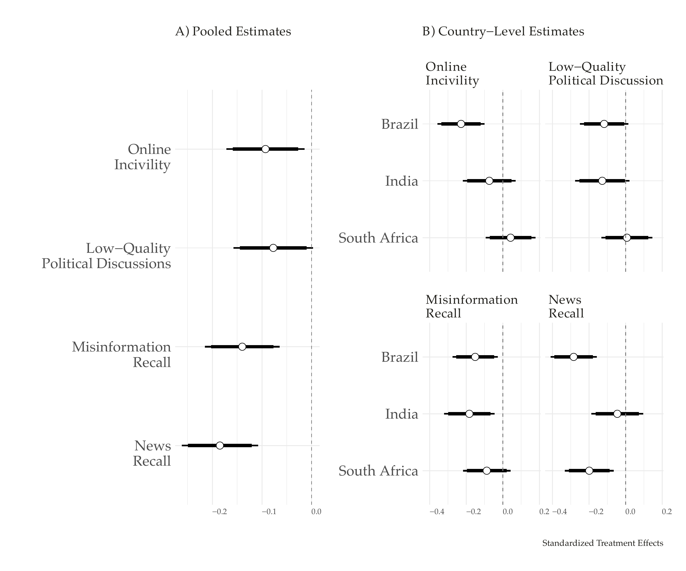{fig-align="center" width="72%"}

::: aside
[Ventura et al., WhatsApp deactivation experiment in Brazil, India and South Africa. Less WhatsApp meant less misinformation, less incivility, and less news.]{.midgray}
:::

::: notes
Takeaway: Social media: WhatsApp still carries misinformation.
:::

## The Role of Social Media {.center}

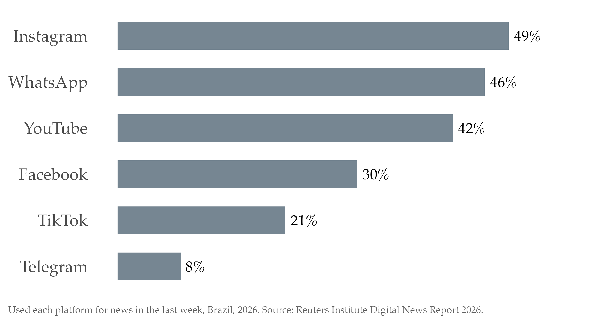{fig-align="center" width="72%"}

::: notes
Takeaway: Instagram, WhatsApp and YouTube are where Brazilians find news.

Instagram, WhatsApp and YouTube all above 40%. A third of Brazilians get news from creators and influencers. Trust in news hit a 12-year low (36%). The 2025-26 jumps in Instagram and WhatsApp are large for one year, so I show levels only.
:::

## The Role of Social Media {.center}

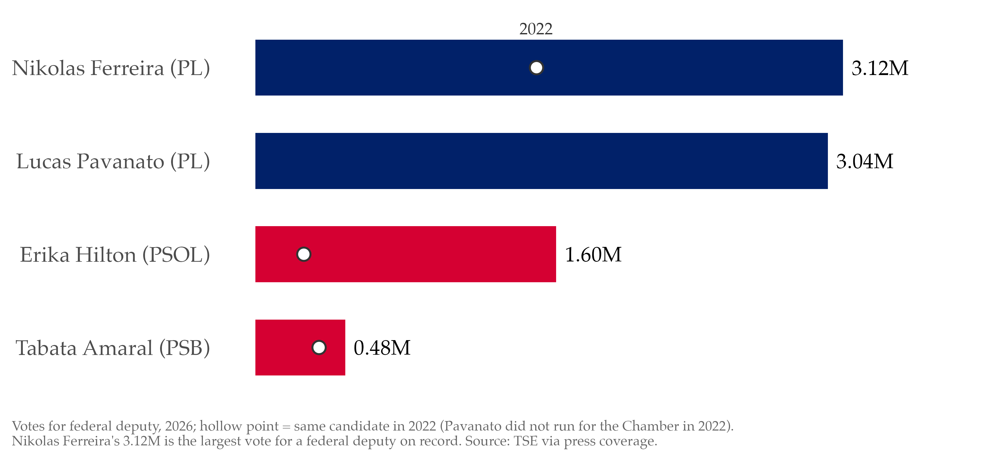{fig-align="center" width="85%"}

::: notes
Takeaway: The two most-voted deputies are PL influencers.
:::

## The Role of Social Media {.center}

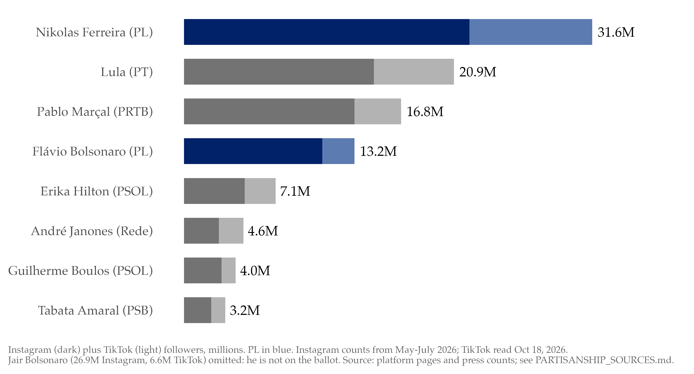{fig-align="center" width="85%"}

::: notes
Takeaway: Nikolas Ferreira has more followers than Lula.

Nikolas, 30, has 22.1M on Instagram and 9.5M on TikTok. Jair Bolsonaro still leads overall (26.9M Instagram, 13.9M X). Flávio gained 1.74M followers across platforms in the four days after the first round.
:::

## The Role of Social Media {.center}

:::: {.columns}

::: {.column width="50%"}
[The left: the platforms]{.red}

::: {.headline}
Campanha de Lula acusa Meta de interferir nas eleições em favor de Flávio
[CNN Brasil, Oct 10, 2026]{.src}
:::

::: {.headline}
TSE proíbe Meta de interferir na distribuição de conteúdos de Lula e Flávio Bolsonaro
[NC News, Oct 16, 2026]{.src}
:::
:::

::: {.column width="50%"}
[The right: the courts]{.blue}

::: {.headline .right}
Flávio Bolsonaro desiste de debate da Globo e acusa TSE de censura
[Congresso em Foco, Oct 1, 2026]{.src}
:::

::: {.headline .right}
Why the Trump Administration Is Being Accused of Interfering in Brazil's Election
[TIME, Oct 2, 2026]{.src}
:::
:::

::::

::: notes
Takeaway: Both sides say the referee is biased.

PT report: Flávio's posts got about 3x Lula's per-post engagement with 17% fewer followers. Meta denies manipulation but admitted a video-metrics bug. TSE ordered equal distribution through the runoff (R$500k daily fine) without finding deliberate manipulation. On the right: Lupa counted at least 36 TSE decisions on Flávio's own takedown requests; Flávio and PL had filed 244 actions by Oct 5.
:::

## What Will Happen Next Sunday? {.center}

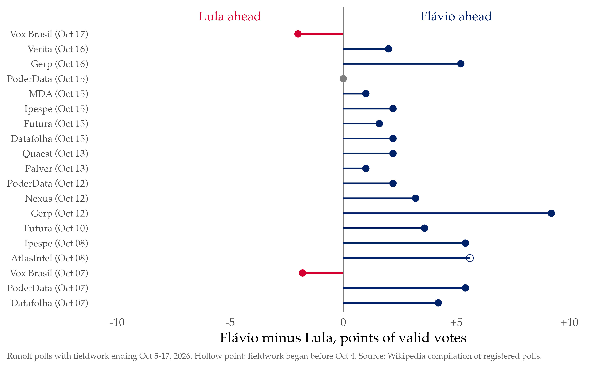{fig-align="center" width="82%"}

::: notes
Takeaway: Flávio leads 16 of 19 runoff polls.

Average Flávio margin: 2.8 points of valid votes. The two Lula leads are both Vox Brasil. Since 1989 no second-place finisher in a first round has won the runoff.
:::

## What Will Happen Next Sunday? {.center}

:::: {.columns}

::: {.column width="50%"}
[If Flávio wins]{.blue}

- Close alignment with Trump, and more US security presence in the region
- A right-wing agenda that runs almost unconstrained in Congress
- Open conflict with the Supreme Court, where three justices hit mandatory retirement before 2031
:::

::: {.column width="50%"}
::: {.fragment}
[If Lula wins]{.red}

- A minority government facing a PL that holds the largest caucus in both chambers
- A fight for survival from day one
:::
:::

::: notes
Takeaway: Two very different Brazils.

Mandatory retirement at 75: Fux (Apr 2028), Cármen Lúcia (Apr 2029), Gilmar Mendes (Dec 2030).
:::

::::

::: aside
[Cesar Zucco (Michigan, Oct 2026): "If elected, Lula will probably not finish his term. If elected, right-wing agenda will be mostly unconstrained."]{.midgray}
:::

## {background-color="#23395b"}

::: {.center .larger-font}
[Brazil voted much as it did in 2022. What changed is the right: it now has a party, partisans, and a patron in Washington.]{style="color:white"}
:::

::: {style="color:white; text-align:center; font-size:0.7em; margin-top:40px"}
Tiago Ventura · tv186@georgetown.edu
:::
