## {.title-hero data-state="title-hero"}

```{=html}
<div class="hero hero-centered">
  <div class="hero-left">
    <div class="hero-kicker">Center for Information Networks and Democracy &middot; University of Pennsylvania &middot; 2026</div>
    <h1 class="hero-title">The Partisan Effects of Information Control Policies: Evidence from the X&nbsp;Ban in&nbsp;Brazil</h1>
    <div class="hero-rule"></div>
    <p class="hero-presenter"><strong>Tiago Ventura</strong> (Georgetown University)</p>
    <p class="hero-authors">With Christopher Barrie, Margaret E. Roberts, Christopher Schwarz, and Joshua A. Tucker</p>
  </div>
</div>
```


## Motivation {.sec-intro}


Social media is often blamed for facilitating the spread of misinformation. As a consequence, governments are increasingly trying to control what circulates online. 

... And platforms often fight back such efforts:

- **Europe:** Platforms launched legal challenges against EU fines under the Digital Services Act

- **Brazil:** As Congress prepared to vote on a misinformation bill, Google put a link on its homepage urging users to lobby their representatives against it

- **United States:** Facing a shutdown, TikTok sent push notifications asking users to act against the proposal


## In democracies... {.center .sec-intro}

- These conflicts are rarely confined to governments and platforms. 

- Norms around content moderation tap into partisan values (freedom of speech vs information control) ~ these conflicts often become partisan

- Once they become partisan, [enforcing content moderation]{.red} becomes one more issue citizens divide over.

## Brazil took this conflict further than any other democracy {.center .sec-intro}

- After Bolsonaro's 2022 defeat, right-leaning supporters contested the results with truck lockouts, encampments, a strong digital campaign on social media, and a riot in the Congress on January 8

- Supreme Court orders X to remove accounts under investigation for election misinformation and for mobilizing the January 8, 2023 attacks

- X refuses, closes its Brazilian office, withdraws its legal representative

  - **August 30, 2024:** nationwide ban on X disrupting the online routines of ~40 million people

  - **October 8, 2024:** ban lifted after X complies


## Prior Work {.sec-intro}

::: {.incremental}

- Work on democracies focuses on **policy preferences** about content moderation: partisan alignment shapes support for content moderation [(Appel et al. 2023; Kozyreva et al. 2023)]{.midgrey}

- Work on **behavior** (circumvention, backlash, exit, VPN usage) comes almost entirely from autocracies [(King et al. 2014; Roberts 2018; Hobbs and Roberts 2018; Pan and Siegel 2020; Boxell and Steinert-Threlkeld 2022)]{.midgrey}

- Fewer studies on **behavioral effects** of conflicts over content moderation + changes in information space. 

:::


## {.center .sec-intro}

::: {.center .larger-font}

How do [partisan dynamics]{.red} shape compliance with state-imposed platform bans (an extensive for me information control policies) 

and what are the consequences for the [information environment]{.blue} in a polarized democracy?

:::


## Preview: the ban sorted users by partisanship {.center .sec-intro}

- Right-leaning users **circumvented** the ban.

- Left-leaning users almost entirely **went silent**.

- The information environment shifted **sharply right** in the short run and didn't fully snap back after the ban.

- These changes also affected overall engagement in the platform (not only posting rates) and who returns to the platform after the ban


# Theory {.rq-divider .d1}

A ban forces a choice: exit or circumvent

## A ban forces a choice: exit or circumvent {.center .sec-theory}

::: {.nonincremental}

- **Exit** = compliance

- **Circumvention** (VPN) = non-compliance

:::

::: {.fragment}

Users weigh the costs of staying (technical friction, legal risk, vpn costs) against the benefits: information and voice (coordination, agenda-setting, influence).

:::


## Politicization changes the payoff differently for each side {.center .sec-theory}

::: {.incremental}

- **Reputational incentives:** Complying signals respect for institutions; circumventing signals defiance or loyalty, depending on what one's audience rewards

- **Informational incentives:** If co-partisans leave, the remaining content becomes less congenial and less useful, lowering the payoff to staying

- A credible alternative (a recent trend in fragmentation of the social media space) makes coordinated exit easier to sustain

:::

::: {.incremental}

- **Right-leaning users** had reasons to circumvent: defiance, keeping their voice and their audience

- **Left-leaning users** had reasons to comply: normative alignment with the Court, fear of looking like the other camp, Bluesky as an alternative

:::

## The sorting ratchet: a partisan version of the Streisand effect {.center .sec-theory}


::: {.fragment}

In autocracies, backlash unites citizens against the state. In polarized democracies, it [segments along partisan lines]{.red}.

:::


::: {.fragment}

**Sorting:** co-partisans make similar exit/stay decisions, balkanizing the platform along partisan lines

:::

::: {.fragment}

**Ratchet:** habits form during the ban, so the effect does not fully reverse once the platform is unblocked

:::

## Bans are the extreme end of a distribution of enforcement actions {.center .sec-theory}

::: {.incremental}

- Takedown orders, fines, threats of suspension, deplatforming [(Mitts 2025)]{.midgrey} can all turn a platform into a political object

- When a platform complies, staying on it signals support for the policy , and information one side considers harmful becomes scarcer

- Expectation: milder actions produce the **same sorting**, slower and smaller but cumulative


:::


# Data & Design {.rq-divider .d2}

14M Decahose tweets to estimate ideology; 7,471 users tracked across seven months


## Pre-ban data: 14M tweets from the X Decahose to estimate ideology {.center .sec-design}

**Source:** X Decahose API, a 10% real-time sample of all public tweets

- 90 days before the ban (June - August 2024)
- Filtered to Portuguese-language tweets containing a URL
- **~14 million tweets** in total
- Feeds the user × news-domain matrix used to estimate ideology
- [The Decahose was retired shortly after collection. This means this dataset can no longer be rebuilt.]{.midgrey}


## Panel data: 7,471 politically engaged users tracked across 7 months {.center .sec-design}

**Source:** full timelines scraped via public *Nitter* instances (we lost Decahose access mid-project)

- **Sample frame:** users in the pre-ban data who shared at least 5 distinct political news domains → 9,061 candidates
- **Collected: 7,471 of 9,061** (attrition from deletions, handle changes, suspensions, private accounts)
- **Window:** June 1 - December 31, 2024
- **~6.7M tweets**, **~430K political news shares**
- Non-random sample, but a small share of users generates most political content [(Grinberg et al. 2019; Baribi-Bartov et al. 2024)]{.midgrey}


## Correspondence analysis recovers ideology from news sharing {.center .sec-design}

$$
\underbrace{\begin{array}{c|cccccc}
 & \text{folha} & \text{globo} & \text{jovempan} & \text{oeste} & \cdots \\
\hline
\text{user}_1 & 12 & 8 & 0 & 0 & \cdots \\
\text{user}_2 & 0 & 1 & 15 & 9 & \cdots \\
\text{user}_3 & 7 & 11 & 2 & 0 & \cdots \\
\vdots & \vdots & \vdots & \vdots & \vdots & \ddots
\end{array}}_{\textbf{9,061 users}\;\times\;\textbf{242 domains}}
$$

[Each cell = number of times user $i$ shared a link from domain $j$. The first CA dimension orders users and domains from left to right; *user*$_1$ looks left-leaning, *user*$_2$ right-leaning.]{.midgrey}


## We restrict the matrix to political domains and engaged users {.center .sec-design}

::: {.fragment}

**Filtering**

- Domains: shared more than 50 times, classified as Brazilian political news (GPT-4o, then manual review), shared by at least 10 users
- Users: shared at least 5 distinct political news domains
- **Intuition:** make politics the main dimension of the sharing space

:::

::: {.fragment}

**Estimation**

- Correspondence analysis on the user × domain matrix [(Eady et al. 2025)]{.midgrey}
- First dimension = ideological position for users *and* domains

:::


# Validation {.rq-divider .d3}

Do behavioral ideology scores recover what we think they recover?


## Ideology scores have strong face validity {.center .sec-valid}

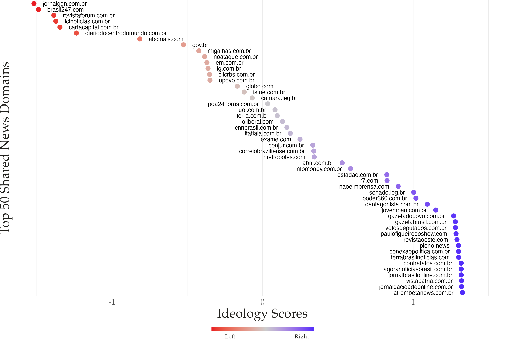{fig-align="center" width="72%"}


## Behavioral scores correlate at r = 0.85 with survey-based measures {.center .sec-valid}

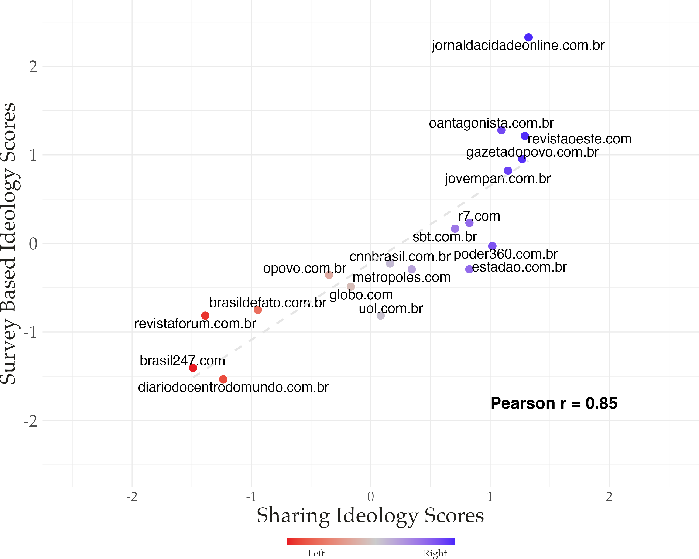{fig-align="center" width="65%"}


[Survey-based ideology from Mont'Alverne et al. (2024), matched on 24 organizations]{.midgrey}


# Results: General Effects {.rq-divider .d4}

What happened to posting and news sharing?


## The ban cut daily tweets by 70% but not to zero {.center .res1}

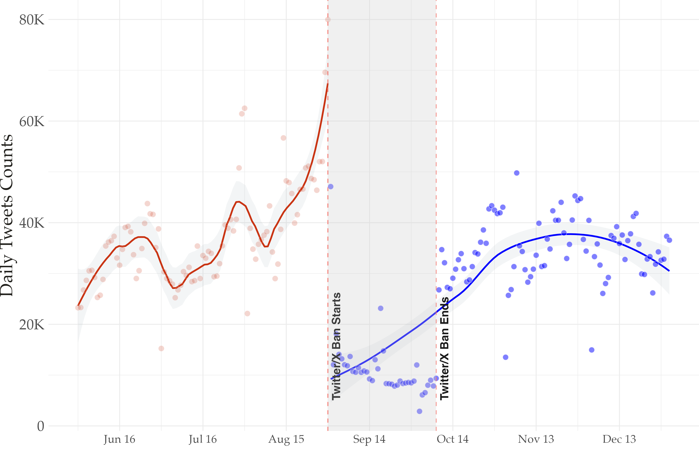{fig-align="center" width="72%"}


[Daily totals across users: 37,207 tweets before the ban, 11,305 during.]{.midgrey}


## News sharing fell 85% and bounced back to pre-ban levels, not above {.center .res1}

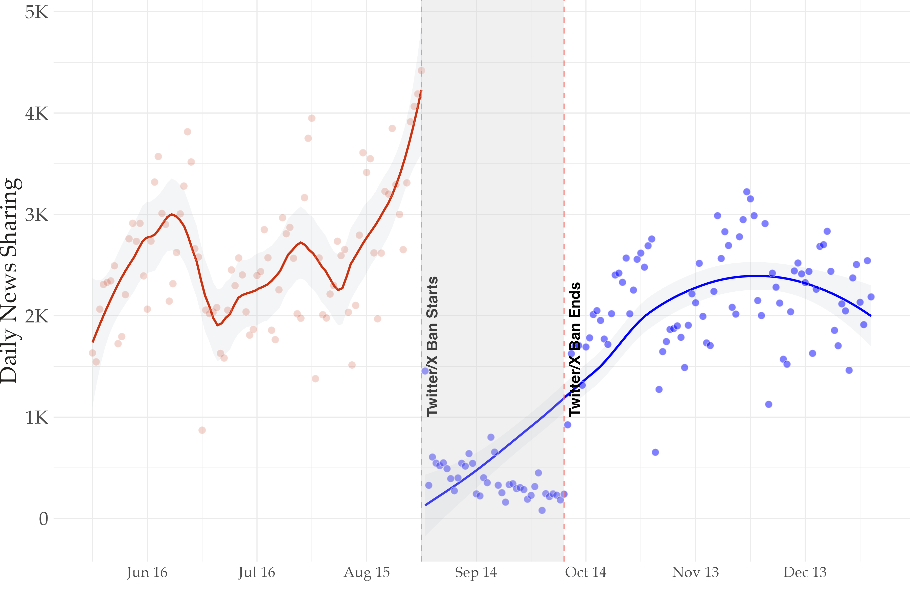{fig-align="center" width="72%"}

[2,587 political news shares per day before the ban, 395 during. No overall Streisand effect: usage returns to baseline rather than rising as a backlash.]{.midgrey}


# Results: Partisan Effects {.rq-divider .d5}

Who stayed, who left, and who came back?


## We estimate partisan responses with a Poisson event study {.res2}

$$y_{ij} \sim \text{Poisson}(\lambda_{ij})$$

$$\lambda_{ij} = \exp\left(\alpha_i + \tau_j + \sum_{t=1}^{6} \beta_t \cdot \text{Right-leaning}_i \cdot \text{Month}_t\right)$$

::: {.fragment}

- $y_{ij}$: tweets by user $i$ on day $j$
- $\alpha_i$, $\tau_j$: user and day fixed effects
- $\text{Right-leaning}_i$:ideology score > 0
- $\beta_t$: **how much more active right-leaning (vs left-leaning) users are in month $t$**, relative to June
- Errors clustered by user

:::


## Right-leaning users posted at 5.8x the rate of left-leaning users during the ban {.center .res2}

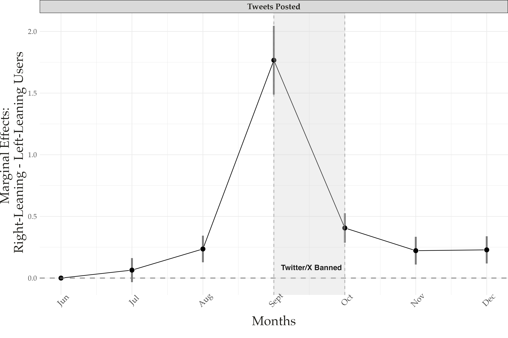{fig-align="center" width="72%"}


[September: β = 1.76, exp(β) = 5.8, z = 12.6. Effects persist at smaller magnitude after the ban.]{.midgrey}


## The partisan gap opened in August before the ban {.center .res2}

:::: {.columns}

::: {.column width="62%"}

{fig-align="center" width="100%"}

:::

::: {.column width="38%"}

<br>

| Month | β | Rate ratio |
|-------|------|-----------|
| July | 0.07 | 1.07 |
| **August** | **0.24*** | **1.27** |
| Sept. (ban) | 1.77*** | 5.8 |

[July n.s.; *** p < 0.01]{.midgrey}

:::

::::


## Escalation alone started the sorting; enforcement amplified it {.center .res2}

::: {.incremental}

- Activity starts climbing in **mid-August**, as the conflict escalates.  X announces the closure of its Brazilian office on August 17

- No block is in place yet, but the platform is already seeing a **sorting process**

- The gap **increases** once the ban is enforced, and continues, never returning to the June baseline

- Not an inferential problem, but actually a substantive finding: the treatment is the **politicization of enforcement**, and the ban is its most extreme form

:::


## Right-leaning news domains also became more prevalent during the ban {.center .res2}

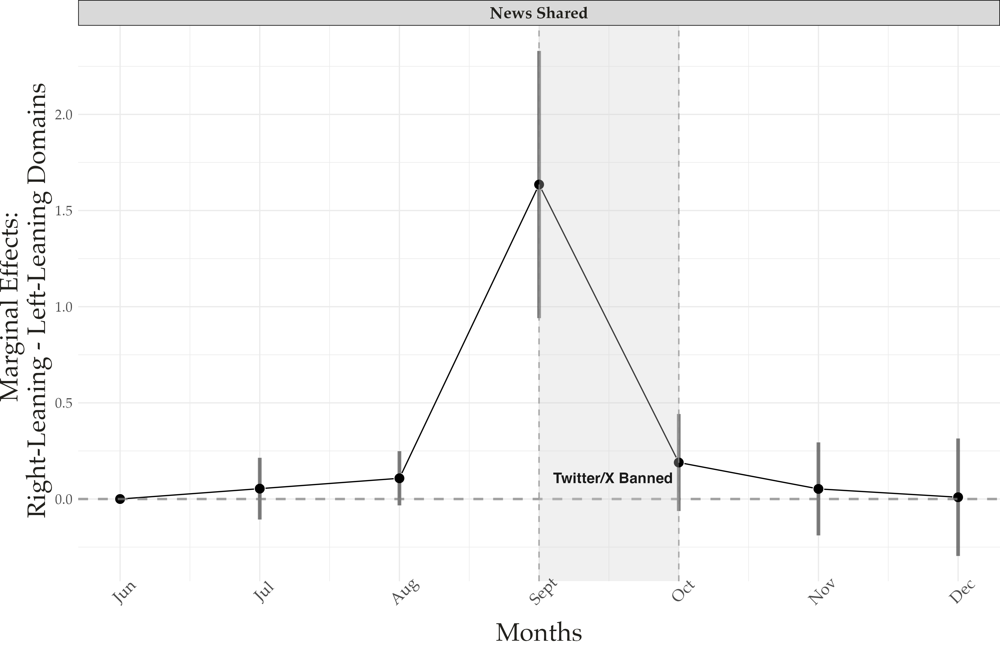{fig-align="center" width="72%"}

::: notes
[Same specification at the domain level, errors clustered by domain. Less precise due to smaller N (September: β = 1.64, p < 0.01).]{.midgrey}
:::


## Right-leaning users produced most of the content during and after the ban {.center .res2}

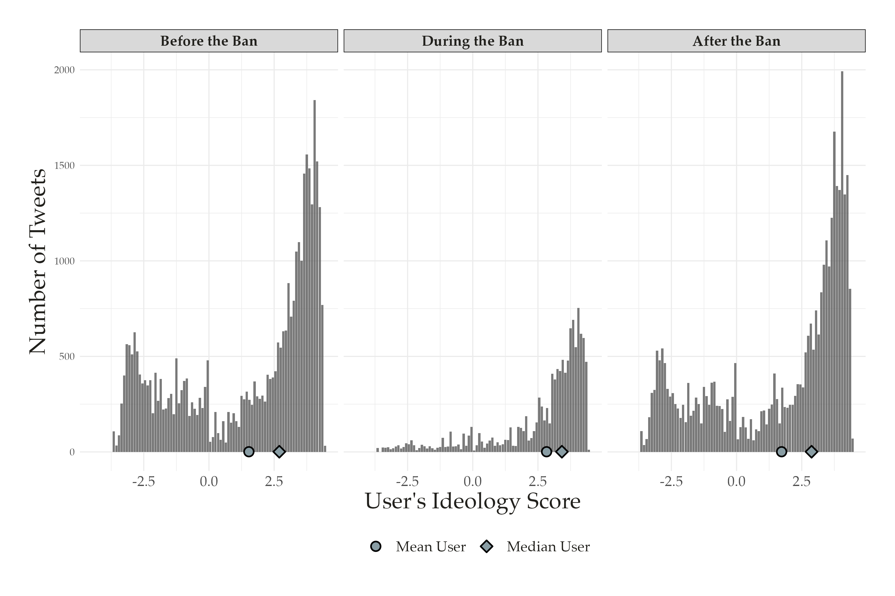{fig-align="center" width="70%"}


[Centrist and left-leaning users largely went silent during the ban.]{.midgrey}


## Left-leaning users dropped out at higher rates and 9% never returned {.center .res2}

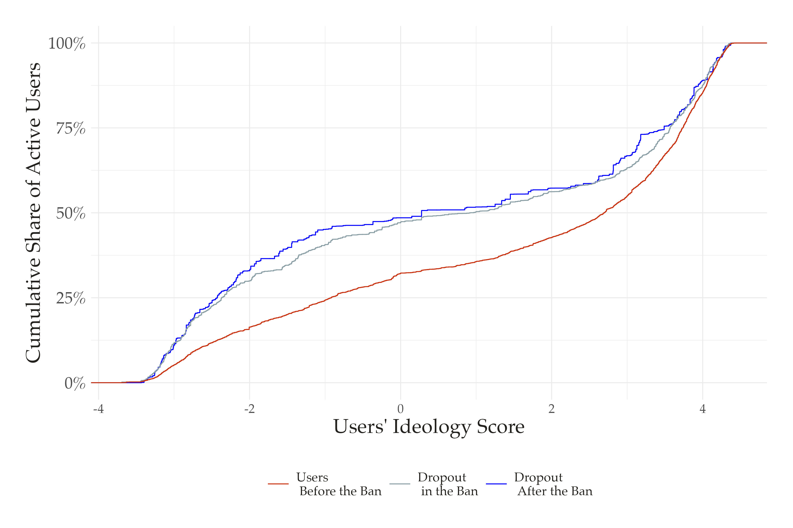{fig-align="center" width="68%"}

[7,291 users active pre-ban; 2,346 fully complied during the ban; 656 never returned. Right-leaning users are ~70% of the pre-ban sample but ~50% of dropouts.]{.midgrey}


## Accounts we could not collect also lean left {.center .res2}

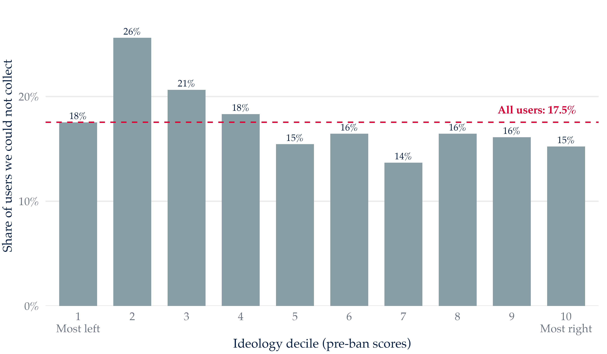{fig-align="center" width="72%"}

[Timelines collected for 7,471 of the 9,061 users identified pre-ban; the rest were deleted, renamed, suspended, or private. Uncollected users post and share news at the same rates as collected ones.]{.midgrey}


# Results: Downstream Effects {.rq-divider .d6}

What happened to the information environment?


## The news environment shifted 1.05 SD to the right during the ban {.center .res3}

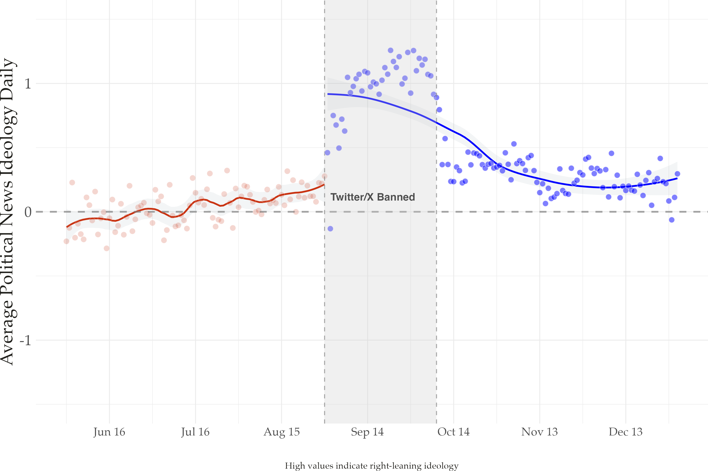{fig-align="center" width="70%"}


[Median domain ideology: 0.27 before, 1.26 during, 0.30 after (0.04 SD to the right of baseline)]{.midgrey}


## Engagement became concentrated among right-leaning users and stayed that way {.center .res3}

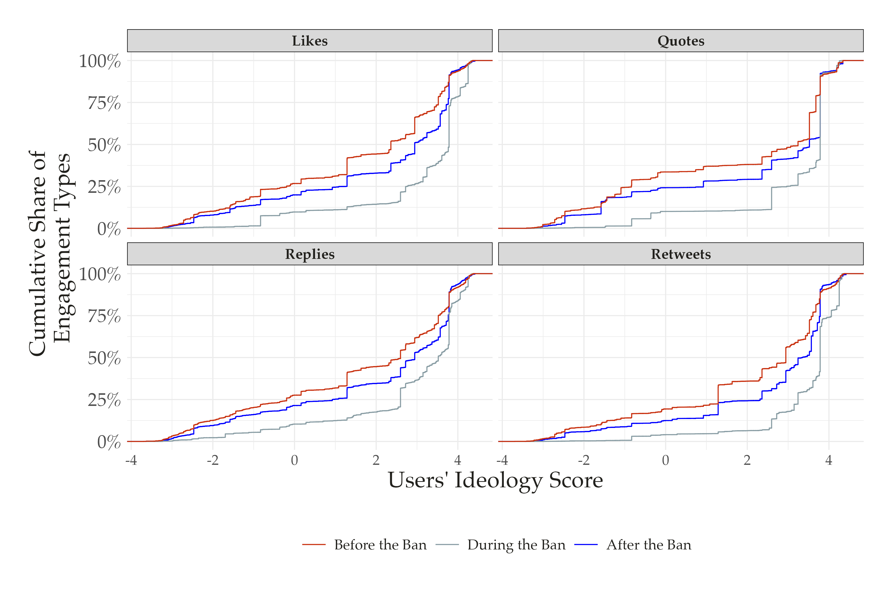{fig-align="center" width="70%"}

[Right-leaning users received 73% of likes pre-ban, 90% during, and 80% after. Similar patterns for retweets, quotes, and replies.]{.midgrey}


# Alternative Explanation: VPN Access {.rq-divider .d7}

Is it partisanship, or just easier access to VPNs?


## Maybe it's not partisanship,  maybe the right just has easier access to VPNs {.center .sec-vpn}

::: {.incremental}

- Circumventing the ban required a **VPN**

- VPN access may track **income**

- Income is associated with **right-wing preferences** in Brazil [(Layton et al. 2021; Zanotti et al. 2023; Rennó et al. 2026)]{.midgrey}

- If so, right-leaning users stayed because they *could*, not because they *wanted to*

:::


## An original survey of Brazilian internet users measures VPN use {.center .sec-vpn}

::: {.nonincremental}

- Fielded April 2026, **n = 1,694** (2 years after the ban)

- Asks whether respondents use a VPN now, used one in the past, never used one, or don't know what a VPN is

- Three outcomes: **uses now**, **ever used**, **used in the past but not now**

- Logit models with ideology, income, education, digital literacy, age, gender, race, platform use, and region fixed effects

:::


## VPN use in Brazil is rare and past users outnumber current ones {.center .sec-vpn}

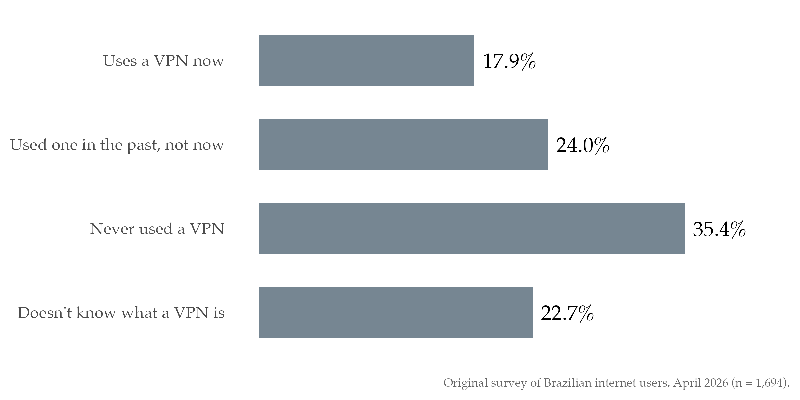{fig-align="center" width="72%"}


## Digital literacy predicts VPN use; income and ideology don't {.center .sec-vpn}

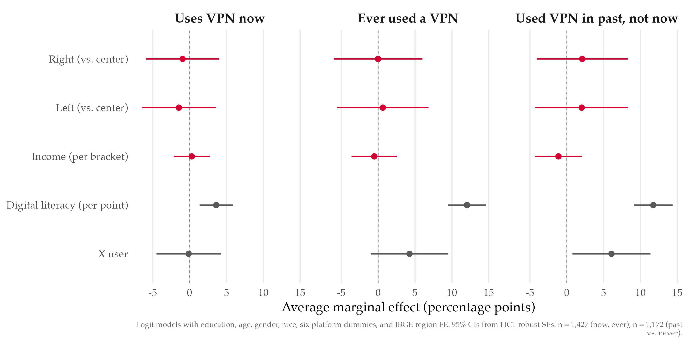{fig-align="center" width="100%"}


## X users are more likely to have used a VPN and then stopped {.center .sec-vpn}

::: {.fragment}

X users are [6.1 percentage points]{.red} more likely to report using a VPN in the past but not now [(95% CI: 0.8 to 11.4; n = 1,172)]{.midgrey}

:::

::: {.fragment}

- Suggestive, but consistent with **temporary circumvention** during the ban

- No partisan baseline in VPN access: the partisan gap on X reflects **partisan motivation**, not baseline differences
:::


# The Sorting Ratchet {.rq-divider .d8}

Asymmetric compliance + selective dropout = lasting partisan segmentation


## Asymmetric compliance + selective dropout = lasting partisan segmentation {.center .sec-concl}

::: {.nonincremental}

1. **Enforcement is politicized:** the right opposed the Court's decision; the left supported it

2. **Compliance diverges:** conservatives circumvent; progressives comply or exit to alternatives

3. **The platform tilts right:** content, news, and engagement all shift toward conservative users

4. **The ratchet locks in:** after the ban lifts, left-leaning users don't fully return and the rightward shift persists

:::


## Implications {.center .sec-concl}

::: {.incremental}

1. Conflicts over content moderation in **polarized democracies** can produce durable partisan shifts in participation

2. **These changes are sticky.** Three months after the ban, X was still more conservative, and 9% of users never came back

3. **Echo chambers at the platform level:** fragmentation is no longer only a region of the user graph, it is the full platform. 

4. **Policy trade-off:** measures meant to curb misinformation can reallocate control of the information environment

:::


## Next steps {.center .sec-concl}

::: {.nonincremental}

- Working now on dynamic measures of polarization before and after the ban based on the tweets

- Understand more about the sample of politically engaged users: how much of the overall content we collect they really represent? 

:::


# Thank You ! {.rq-divider .d10}


